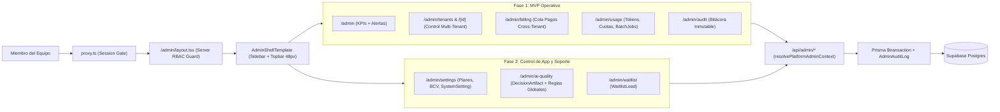

# Plan de Implementación — Consola de Administración Multi-Tenant (`/admin`)

## Objetivo y Contexto

Diseñar e implementar una interfaz administrativa interna (`/admin`) para que tu equipo pueda operar TariffOS v3 y controlar todos los **tenants**, su **facturación manual**, su **consumo de IA/cuotas** y la **configuración global de la plataforma**, con aislamiento estricto respecto a los usuarios clientes.

### Estado actual detectado en el repositorio
Al revisar el código actual se identificaron tres puntos de partida clave:
1. **Base de datos ya preparada en un 85%:** [schema.prisma](file:///Users/afernandez/projects/tariffos-v3/packages/database/prisma/schema.prisma) ya incluye `Tenant`, `Plan`, `Payment`, `UsageRecord`, `BillingPeriod`, `Membership`, `BatchJob`, `DecisionArtifact`, `SystemSetting`, `ExchangeRate`, `Country`, `CustomClassificationRule`, `WaitlistLead` y `UserProfile.role`.
2. **Primera vista existente pero aislada:** [page.tsx](file:///Users/afernandez/projects/tariffos-v3/apps/web/src/app/admin/billing/page.tsx) renderiza [AdminBillingQueue.tsx](file:///Users/afernandez/projects/tariffos-v3/apps/web/src/components/funnel/organisms/AdminBillingQueue.tsx), pero sin shell compartido de administración ni navegación hacia tenants o métricas.
3. **Brecha crítica de autorización actual:**
   - [proxy.ts](file:///Users/afernandez/projects/tariffos-v3/apps/web/src/proxy.ts) y [route-gate.ts](file:///Users/afernandez/projects/tariffos-v3/apps/web/src/lib/supabase/route-gate.ts) solo verifican `hasSession` en `/admin`, sin validar rol interno de plataforma.
   - En [route.ts](file:///Users/afernandez/projects/tariffos-v3/apps/web/src/app/api/billing/payments/route.ts), `PATCH` permite que **cualquier usuario autenticado** apruebe o rechace cualquier `paymentId`, y `GET` filtra por `auth.context.tenantId`, lo que impide a un admin ver pagos de otros tenants en modo cloud.

---

## User Review Required

> [!IMPORTANT]
> **Modelo de Roles de Plataforma (RBAC Interno):** Se propone usar `UserProfile.role` (tabla `public.profiles`) con 4 valores tipados: `user` (default cliente), `support`, `ops_billing` y `super_admin`. Ningún rol de `Membership.role` (como `OWNER` de una agencia aduanal) otorgará acceso a `/admin`.

> [!WARNING]
> **Separación de Endpoints de Pagos:** Se propone cerrar `PATCH` en `/api/billing/payments` (dejándolo solo para que el cliente reporte y consulte *sus propios* pagos) y mover la cola multi-tenant + aprobación/rechazo a `/api/admin/billing/payments` protegido por permiso `billing:approve`.

> [!CAUTION]
> **Alcance de Fase 1 vs. Fase 2:** Para no sobrediseñar, el plan divide el trabajo en **Fase 1 (MVP Operativo de Lanzamiento)** y **Fase 2 (Control Global y Soporte Avanzado)**. Operaciones de infraestructura (colas Inngest, backups Supabase, logs Vercel) quedan fuera de `/admin` deliberadamente.

---

## Open Questions (para alinear en `/grill-me`)

> [!IMPORTANT]
> Estas decisiones definirán los detalles finales antes de escribir código:
> 1. **Roles del equipo:** ¿Te bastan los 3 roles internos propuestos (`super_admin`, `ops_billing`, `support`) o al inicio solo necesitas `super_admin` + `ops`?
> 2. **Alta inicial de admins:** ¿Cómo prefieres asignar el primer `super_admin`? (Opción A: variable de entorno `PLATFORM_ADMIN_EMAILS` como bootstrap + persistencia en `profiles.role`; Opción B: solo vía script/seed de DB).
> 3. **Modo soporte / Impersonation:** ¿Tu equipo necesitará entrar en modo *solo lectura* a ver el workspace de un tenant, o basta con inspeccionar sus `BatchJob`, `Filing` y `DecisionArtifact` desde `/admin`?
> 4. **Aprobación de pagos manuales:** Al aprobar un pago, ¿debe actualizar automáticamente `Tenant.planId`, `Tenant.billingLimit`, `Tenant.billingStatus = 'ACTIVE'` y crear/cerrar `BillingPeriod` en la misma transacción?
> 5. **Configuración global en Fase 2:** ¿Qué parámetros quieres editar desde UI (`ExchangeRate` BCV, precios/límites de `Plan`, `SystemSetting`, `CustomClassificationRule` global, `WaitlistLead`) y cuáles prefieres mantener solo en código/migraciones?

---

## Arquitectura Propuesta

### Flujo de Seguridad y Módulos



### Matriz de Permisos Propuesta (`PlatformRole`)

| Permiso | `super_admin` | `ops_billing` | `support` | `user` |
| :--- | :---: | :---: | :---: | :---: |
| Acceder a `/admin` y KPIs | Sí | Sí | Sí | No (403) |
| Ver lista y detalle de tenants | Sí | Sí | Sí | No |
| Editar plan, cuota, overage o suspender tenant | Sí | Sí | No | No |
| Ver cola de pagos cross-tenant | Sí | Sí | Sí (lectura) | No |
| Aprobar / rechazar pagos manuales | Sí | Sí | No | No |
| Ver consumo IA (`UsageRecord`) y `BatchJob` | Sí | Sí | Sí | No |
| Editar `SystemSetting`, `Plan`, `ExchangeRate` | Sí | No | No | No |
| Gestionar roles de otros admins | Sí | No | No | No |
| Ver `AdminAuditLog` | Sí | Sí (propios/billing) | No | No |

---

## Proposed Changes

### 1. Base de Datos y Auditoría (`packages/database`)

Añadir trazabilidad inmutable para todas las mutaciones administrativas y un servicio dedicado en `@tariffos/database`.

#### [MODIFY] [schema.prisma](file:///Users/afernandez/projects/tariffos-v3/packages/database/prisma/schema.prisma)
Agregar el modelo append-only `AdminAuditLog` (sin `updatedAt` ni borrado):

```prisma
model AdminAuditLog {
  id           String   @id @default(cuid())
  actorUserId  String   @map("actor_user_id")
  actorEmail   String?  @map("actor_email")
  actorRole    String   @map("actor_role")
  action       String   // e.g. "tenant.plan_updated", "payment.verified", "tenant.suspended"
  targetType   String   @map("target_type") // "tenant" | "payment" | "plan" | "setting" | "admin_user"
  targetId     String   @map("target_id")
  tenantId     String?  @map("tenant_id")
  beforeState  Json?    @map("before_state")
  afterState   Json?    @map("after_state")
  reason       String?
  createdAt    DateTime @default(now()) @map("created_at")

  @@index([actorUserId, createdAt(sort: Desc)])
  @@index([tenantId, createdAt(sort: Desc)])
  @@index([action, createdAt(sort: Desc)])
  @@map("admin_audit_logs")
  @@schema("public")
}
```

#### [NEW] `packages/database/src/admin-audit.ts`
Helper puro `recordAdminAudit(tx, entry)` que recibe el cliente de transacción Prisma (`Prisma.TransactionClient`) para garantizar que **ninguna mutación admin ocurra sin su registro de auditoría en la misma transacción**.

---

### 2. Contratos Compartidos (`packages/shared-types`)

#### [NEW] `packages/shared-types/src/admin.ts`
Schemas Zod y tipos estrictos (`<= 200` LOC):
- `PlatformRoleSchema`: `z.enum(['user', 'support', 'ops_billing', 'super_admin'])`
- `AdminPermissionSchema`: unión discriminada de permisos de la matriz RBAC.
- `AdminTenantSummarySchema` y `AdminTenantDetailSchema`
- `AdminTenantPatchSchema`: `{ planId?, billingLimit?, billingStatus?, allowOverage?, countryCode?, reason }` (exige `reason` mínimo 3 caracteres para auditoría).
- `AdminUsageRowSchema`, `AdminOverviewMetricsSchema`, `AdminAuditLogItemSchema`.

#### [MODIFY] `packages/shared-types/src/index.ts`
Re-exportar los contratos de `admin.ts`.

---

### 3. Capa de Seguridad Admin (`apps/web/src/lib/admin/`)

#### [NEW] `apps/web/src/lib/admin/permissions.ts`
Mapa determinista `ROLE_PERMISSIONS` y helper puro `hasAdminPermission(role, permission)` (100% testeable en unidad sin red).

#### [NEW] `apps/web/src/lib/admin/admin-session.ts`
Guard server-side `resolvePlatformAdminContext(requiredPermission?)`:
1. En modo offline (`!isCloudModeEnabled()`), devuelve un contexto determinista `super_admin` para desarrollo/tests locales.
2. En modo cloud:
   - Obtiene el usuario autenticado vía `getAuthenticatedUser()`. Si no hay usuario -> `401`.
   - Consulta `prisma.userProfile.findUnique({ where: { id: user.id }, select: { role: true } })` (y opcionalmente fallback de bootstrap por `PLATFORM_ADMIN_EMAILS`).
   - Verifica que el rol sea distinto de `'user'` y cumpla `hasAdminPermission(role, requiredPermission)`. Si no -> `403`.

#### [MODIFY] [route-gate.ts](file:///Users/afernandez/projects/tariffos-v3/apps/web/src/lib/supabase/route-gate.ts)
Mantener el redirect a `/login?next=/admin/...` cuando no hay sesión en `/admin/*`, delegando la verificación de rol a `apps/web/src/app/admin/layout.tsx` (evitando consultas Prisma dentro del Edge/proxy).

#### [MODIFY] [route.ts](file:///Users/afernandez/projects/tariffos-v3/apps/web/src/app/api/billing/payments/route.ts)
Eliminar o restringir `PATCH` en la ruta pública de cliente para que los clientes solo puedan `GET` (sus propios pagos) y `POST` (reportar pago), cerrando la brecha de autorización actual.

---

### 4. API Interna de Administración (`apps/web/src/app/api/admin/`)

Todos los handlers siguen el patrón: validar `resolvePlatformAdminContext(permission)` -> validar body/query con Zod -> soportar modo offline/cloud -> ejecutar mutación en `prisma.$transaction` + `recordAdminAudit`.

#### [NEW] `apps/web/src/app/api/admin/overview/route.ts`
`GET`: KPIs consolidados (total tenants por `billingStatus`, pagos `PENDING` y monto acumulado, clasificaciones y tokens del mes en curso, `BatchJob` en `FAILED` o `PROCESSING`).

#### [NEW] `apps/web/src/app/api/admin/tenants/route.ts`
`GET`: Listado paginado con filtros `?q=` (nombre, email, `taxId`), `?status=`, `?planId=`, `?countryCode=`, incluyendo conteo de miembros y consumo del mes actual.

#### [NEW] `apps/web/src/app/api/admin/tenants/[id]/route.ts`
- `GET`: Ficha completa del tenant (`Tenant`, `Plan`, `Membership[]`, últimos `Payment[]`, `UsageRecord[]` de los últimos 6 meses, últimos `BatchJob[]`).
- `PATCH`: Actualiza `planId`, `billingLimit`, `billingStatus`, `allowOverage` o `countryCode` dentro de una transacción con `AdminAuditLog`.

#### [NEW] `apps/web/src/app/api/admin/billing/payments/route.ts`
- `GET`: Lista pagos **cross-tenant** filtrables por estado (`PENDING`, `CONFIRMED`, `REJECTED`) incluyendo nombre del tenant y email del propietario.
- `PATCH`: Aprobar (`verify`) o rechazar (`reject`). Al aprobar, en una sola `$transaction`:
  1. Actualiza `Payment` (`CONFIRMED`, `verifiedBy`, `verifiedAt`).
  2. Actualiza `Tenant` (`billingStatus: 'ACTIVE'`, `planId`, y `billingLimit` sincronizado desde `Plan.classificationLimit` si aplica).
  3. Registra `AdminAuditLog` con `beforeState` / `afterState`.

#### [NEW] `apps/web/src/app/api/admin/usage/route.ts`
`GET`: Ranking de consumo por tenant (clasificaciones, `inputTokens`, `outputTokens`, porcentaje de cuota consumida) + tabla de `BatchJob` recientes o fallidos.

#### [NEW] `apps/web/src/app/api/admin/audit/route.ts`
`GET`: Consulta paginada y filtrable de `AdminAuditLog` por `tenantId`, `action` o `actorEmail`.

#### [NEW] *(Fase 2)* `apps/web/src/app/api/admin/settings/route.ts`
`GET` / `PATCH`: Gestión controlada de `SystemSetting`, tasa `ExchangeRate` y parámetros de `Plan` (solo `super_admin`).

---

### 5. Interfaz Admin en Atomic Design (`apps/web/src/components/admin/` y `apps/web/src/app/admin/`)

Todos los archivos respetarán estrictamente `<= 200` LOC, tokens de [tokens.css](file:///Users/afernandez/projects/tariffos-v3/apps/web/src/app/tokens.css) (`--surface-*`, `--ink-*`, `--accent-*`, `JetBrains Mono` para cifras `tabular-nums`) y TDD.

#### Rutas en `apps/web/src/app/admin/`
- **[NEW] `layout.tsx`**: Server Component que llama a `resolvePlatformAdminContext()`. Si falla (401/403), redirige a `/app` o renderiza una vista limpia de acceso denegado; si pasa, envuelve en `AdminShellTemplate`.
- **[NEW] `page.tsx`**: Dashboard ejecutivo (KPIs de negocio + alertas operativas: pagos pendientes, tenants cerca del límite, batch jobs fallidos).
- **[NEW] `tenants/page.tsx`**: Directorio multi-tenant con búsqueda, filtros por estado/plan y tabla densa.
- **[NEW] `tenants/[id]/page.tsx`**: Panel de control del tenant (cambiar plan/cuota, suspender/activar, ver miembros, pagos y consumo).
- **[MODIFY] [billing/page.tsx](file:///Users/afernandez/projects/tariffos-v3/apps/web/src/app/admin/billing/page.tsx)**: Integrar dentro del nuevo `layout.tsx` (eliminando su header duplicado) y conectar `AdminBillingQueue` al endpoint `/api/admin/billing/payments`.
- **[NEW] `usage/page.tsx`**: Monitor de uso de clasificaciones, tokens LLM y estado de `BatchJob`.
- **[NEW] `audit/page.tsx`**: Visor de bitácora administrativa.
- **[NEW] *(Fase 2)* `settings/page.tsx`**: Editor de `SystemSetting`, `ExchangeRate` (BCV) y `Plan`.

#### Componentes Atomic Design (`apps/web/src/components/admin/`)
- **`atoms/`**: `AdminRoleBadge.tsx`, `TenantStatusBadge.tsx`, `QuotaProgressBar.tsx`, `AdminKpiTile.tsx`.
- **`molecules/`**: `AdminSidebarNav.tsx`, `TenantFilterBar.tsx`, `TenantPlanControlForm.tsx`, `AuditLogRow.tsx`, `UsageMetricRow.tsx`.
- **`organisms/`**: `AdminOverviewGrid.tsx`, `TenantDirectoryTable.tsx`, `TenantControlPanel.tsx`, `UsageMonitorPanel.tsx`, `AuditLogViewer.tsx`.
- **`templates/`**: `AdminShellTemplate.tsx` (topbar 48px + sidebar fija en desktop / drawer en mobile).

---

## Verification Plan

### Automated Tests (TDD Red -> Green -> Refactor)
Se escribirán pruebas Vitest antes de cada módulo de implementación:
1. **Unitarias RBAC y contratos:**
   - `apps/web/src/lib/admin/permissions.test.ts` (matriz completa de roles y permisos).
   - `apps/web/src/lib/admin/admin-session.test.ts` (401 sin sesión, 403 usuario `user`, 403 `support` intentando aprobar pagos, 200 `ops_billing` / `super_admin`).
2. **Integración de APIs:**
   - `apps/web/src/app/api/admin/tenants/route.test.ts` y `[id]/route.test.ts` (filtros, validación Zod de `reason`, escritura de `AdminAuditLog`).
   - `apps/web/src/app/api/admin/billing/payments/route.test.ts` (cola cross-tenant y actualización transaccional).
   - Actualizar `apps/web/src/app/api/billing/payments/route.test.ts` verificando que un usuario no-admin no puede aprobar pagos.
3. **Componentes UI (Testing Library):**
   - `TenantDirectoryTable.test.tsx`, `TenantControlPanel.test.tsx`, `AdminShellTemplate.test.tsx`.
4. **Gate obligatorio del monorepo:**
   ```bash
   pnpm check
   pnpm build
   ```
   Confirmar 0 errores de TypeScript, 0 warnings/errores de `oxlint`, 0 archivos `> 300` LOC (objetivo `<= 200` LOC) y 100% de tests en verde.

### Manual Verification
1. Iniciar sesión como usuario cliente (`role = 'user'`) e intentar acceder a `/admin`, `/admin/tenants` y `PATCH /api/admin/billing/payments` -> confirmar redirección / respuesta `403`.
2. Iniciar sesión como `super_admin`:
   - Aprobar un pago manual en `/admin/billing` y confirmar en `/admin/tenants/[id]` que el tenant cambió a `ACTIVE` con el nuevo plan y apareció el registro en `/admin/audit`.
   - Modificar `billingLimit` y suspender/reactivar un tenant de prueba, verificando que el cambio se refleja en el workspace y en `/admin/audit`.
   - Validar en `/admin/usage` que las cuotas y tokens coinciden con `UsageRecord`.
