# Plan de Implementación — Consola de Administración Multi-Tenant (`/admin`)

## Objetivo y Contexto

Construir una consola administrativa interna (`/admin`) para que tu equipo opere TariffOS v3 centrada desde el día 1 en tus **6 flujos críticos de negocio**:

1. **Crear y gestionar planes** (precios, cuotas de clasificaciones/tokens, overage y planes custom).
2. **Recibir y gestionar leads** (captura desde la landing/formularios hacia `WaitlistLead`, bandeja en `/admin/leads`, seguimiento de estado y botón **1 clic para convertir a Onboarding**).
3. **Onboarding asistido de usuarios y tenants** (dar de alta una agencia/empresa y su usuario principal directamente desde `/admin` con invitación automática).
4. **Aprobar usuarios/tenants que ya pagaron** (verificar pagos manuales o registrar pagos recibidos por WhatsApp/transferencia y activar el plan al instante).
5. **Dar de baja a usuarios o tenants** (cancelación/suspensión inmediata del acceso sin perder el historial legal y auditable de declaraciones).
6. **Ver el consumo por tenant** (clasificaciones del mes vs. `billingLimit`, `inputTokens`/`outputTokens`, overage estimado y estado de `BatchJob`, tanto en ranking global `/admin/usage` como en la ficha `/admin/tenants/[id]`).

### Estado actual detectado en el repositorio
- **Esquema listo en gran parte:** [schema.prisma](file:///Users/afernandez/projects/tariffos-v3/packages/database/prisma/schema.prisma) ya tiene `Plan`, `Tenant`, `Membership`, `Invitation`, `UserProfile` (con `role`), `Payment`, `BillingPeriod` y `UsageRecord`.
- **Supabase Admin ya cableado:** [admin.ts](file:///Users/afernandez/projects/tariffos-v3/apps/web/src/lib/supabase/admin.ts) expone `createSupabaseAdminClient()` con `SUPABASE_SERVICE_ROLE_KEY`, listo para invitar usuarios (`auth.admin.inviteUserByEmail`) o suspenderlos (`auth.admin.updateUserById`).
- **Brecha de seguridad a cerrar primero:**
  - [proxy.ts](file:///Users/afernandez/projects/tariffos-v3/apps/web/src/proxy.ts) solo verifica sesión (`hasSession`) en `/admin`, sin comprobar rol de plataforma.
  - [route.ts](file:///Users/afernandez/projects/tariffos-v3/apps/web/src/app/api/billing/payments/route.ts) permite hoy que cualquier usuario autenticado ejecute `PATCH` sobre cualquier `paymentId`, y su `GET` solo trae pagos del tenant propio.
  - [cloud-session.ts](file:///Users/afernandez/projects/tariffos-v3/apps/web/src/lib/agent/cloud-session.ts) aún no bloquea explícitamente requests de tenants con `billingStatus = 'CANCELED'` cuando se da de baja a un cliente.

---

## User Review Required

> [!IMPORTANT]
> **Seguridad RBAC primero:** Separamos completamente los roles de plataforma (`UserProfile.role`: `user` | `support` | `ops_billing` | `super_admin`) de los roles dentro de un tenant (`Membership.role`: `OWNER` | `MEMBER`). Solo personal con rol de plataforma puede acceder a `/admin` y `/api/admin/*`.

> [!WARNING]
> **Baja lógica y revocación (sin hard-delete):** Por cumplimiento aduanero y trazabilidad legal (`Filing`, `DecisionArtifact`, `Payment`), **dar de baja** nunca borra físicamente registros históricos. En su lugar:
> - **Baja de Tenant:** marca `Tenant.billingStatus = 'CANCELED'`, revoca invitaciones `PENDING` y bloquea el acceso operativo en `/app` y `/api/classify-stream` (con opción de **Reactivar**).
> - **Baja de Usuario:** elimina su `Membership` del tenant y, si ya no pertenece a otro tenant, opcionalmente lo suspende en Supabase Auth (`ban_duration`) para cerrar su acceso de inmediato.

> [!CAUTION]
> **Cierre del endpoint público de pagos:** `PATCH /api/billing/payments` se deshabilita para usuarios normales; la aprobación y rechazo cross-tenant pasan exclusivamente a `/api/admin/billing/payments`.

---

## Open Questions (para tu `/grill-me`)

> [!IMPORTANT]
> 1. **Onboarding asistido:** Cuando das de alta a un cliente desde `/admin`, ¿prefieres enviarle invitación por correo de Supabase (`inviteUserByEmail` con link para crear contraseña) o crear el usuario con contraseña temporal / magic link?
> 2. **Pagos recibidos fuera de la app:** Además de aprobar comprobantes que el cliente subió en `/activate-plan`, ¿necesitas un botón *"Registrar pago manual y activar"* desde `/admin` para clientes que te pagan directo por WhatsApp/Zelle? (Incluido en el plan, confirmar si se queda).
> 3. **Planes custom vs. públicos:** Al crear un plan nuevo en `/admin/plans`, ¿quieres un switch **"Visible en Landing pública"** para poder crear planes privados/negociados solo asignables desde `/admin`?
> 4. **Al dar de baja un tenant:** ¿Quieres que el bloqueo en `/app` sea total (pantalla de *"Cuenta dada de baja"*) o modo *solo lectura* para que pueda descargar sus dictámenes pasados?
> 5. **Roles del equipo:** ¿Te bastan `super_admin` (todo, incluyendo crear planes y gestionar admins) y `ops` (leads, onboarding, aprobar pagos, dar de baja), o quieres también `support` solo lectura?
> 6. **Notificación de nuevos leads:** Además de verlos en `/admin/leads`, ¿quieres recibir una alerta inmediata cuando entre un lead (correo, webhook de WhatsApp/Slack/Telegram) y qué campos extra debería capturar el formulario (ej. nombre, empresa, teléfono/WhatsApp, plan de interés)?

---

## Arquitectura Propuesta

```mermaid
flowchart LR
  Team["Tu Equipo"] --> Proxy["proxy.ts (Session Gate)"]
  Proxy --> Guard["/admin/layout.tsx (Server RBAC Guard)"]
  Guard --> Shell["AdminShellTemplate (Sidebar + Topbar 48px)"]

  subgraph Phase1["Fase 1 — MVP Crítico (Tus 6 Flujos)"]
    P0["/admin/leads — Bandeja de leads + Convertir a Onboarding"]
    P1["/admin/plans — Crear y editar planes"]
    P2["/admin/onboarding — Alta asistida de Tenant + Owner"]
    P3["/admin/billing — Aprobar pagos y activar plan"]
    P4["/admin/tenants & /[id] — Control, consumo y Baja"]
    P5["/admin/usage — Consumo global (cuotas, tokens, BatchJobs)"]
    P6["/admin/audit — Bitácora inmutable"]
  end

  subgraph Phase2["Fase 2 — Expansión Operativa"]
    E2["/admin/settings — BCV, SystemSetting y Reglas Globales"]
    E3["/admin/ai-quality — Inspector de DecisionArtifact"]
  end

  Shell --> Phase1
  Shell --> Phase2

  Phase1 --> Api["/api/admin/* (resolvePlatformAdminContext)"]
  Api --> SupaAdmin["Supabase Auth Admin (invite / ban)"]
  Api --> Tx["Prisma $transaction + AdminAuditLog"]
  Tx --> DB[("Supabase Postgres")]
```



### Matriz de Permisos (`PlatformRole`)

| Acción | `super_admin` | `ops_billing` | `support` | `user` |
| :--- | :---: | :---: | :---: | :---: |
| Ver `/admin`, leads, tenants y pagos | Sí | Sí | Sí | No (403) |
| **1. Crear / editar / archivar planes** | Sí | No | No | No |
| **2. Gestionar leads y convertir a onboarding** | Sí | Sí | No | No |
| **3. Hacer onboarding asistido de tenant/usuario** | Sí | Sí | No | No |
| **4. Aprobar / rechazar / registrar pagos** | Sí | Sí | No | No |
| **5. Dar de baja / reactivar tenant o usuario** | Sí | Sí | No | No |
| Ver bitácora `AdminAuditLog` | Sí | Sí | No | No |
| Gestionar roles de otros admins | Sí | No | No | No |

---

## Proposed Changes — Fase 1 (MVP Crítico)

### 1. Base de Datos y Auditoría (`packages/database`)

#### [MODIFY] [schema.prisma](file:///Users/afernandez/projects/tariffos-v3/packages/database/prisma/schema.prisma)
Agregar `AdminAuditLog` (append-only) para dejar evidencia de cada plan creado, onboarding asistido, pago aprobado y baja ejecutada:

```prisma
model AdminAuditLog {
  id           String   @id @default(cuid())
  actorUserId  String   @map("actor_user_id")
  actorEmail   String?  @map("actor_email")
  actorRole    String   @map("actor_role")
  action       String   // "plan.created" | "tenant.onboarded" | "payment.verified" | "tenant.deactivated" | "user.offboarded"
  targetType   String   @map("target_type") // "plan" | "tenant" | "payment" | "user"
  targetId     String   @map("target_id")
  tenantId     String?  @map("tenant_id")
  beforeState  Json?    @map("before_state")
  afterState   Json?    @map("after_state")
  reason       String?
  createdAt    DateTime @default(now()) @map("created_at")

  @@index([tenantId, createdAt(sort: Desc)])
  @@index([action, createdAt(sort: Desc)])
  @@map("admin_audit_logs")
  @@schema("public")
}
```

> [!NOTE]
> El modelo `Plan` actual ya soporta `name`, `description`, `basePrice`, `classificationLimit`, `maxClassifications`, `maxTokens`, `overagePrice`, `allowOverage` y `features` (`Json`). En `features` podemos almacenar `{ isPublic: boolean, isArchived: boolean, annualPrice?: number, annualOnly?: boolean }` sin migraciones destructivas.

#### [NEW] `packages/database/src/admin-audit.ts`
Helper `recordAdminAudit(tx, entry)` reutilizable dentro de cualquier `prisma.$transaction`.

---

### 2. Contratos Compartidos (`packages/shared-types`)

#### [NEW] `packages/shared-types/src/admin.ts`
Schemas Zod estrictos (`<= 200` LOC):
- `PlatformRoleSchema` y `AdminPermissionSchema`
- `CreatePlanInputSchema` / `UpdatePlanInputSchema` (nombre, precio base, límite de clasificaciones, tokens, overage, `isPublic`, `isArchived`)
- `AdminOnboardTenantInputSchema` (empresa, RIF/`taxId`, país, `ownerName`, `ownerEmail`, `planId`, `billingStatus` inicial `'TRIALING' | 'ACTIVE'`, `billingLimit?`, `sendInviteEmail`)
- `AdminVerifyPaymentInputSchema` y `AdminRecordManualPaymentInputSchema`
- `DeactivateTenantInputSchema` (`reason` obligatorio, `revokePendingInvites`, `banSoleMembers`) y `OffboardUserInputSchema` (`tenantId`, `userId`, `reason`, `banAuthAccount`)

#### [MODIFY] `packages/shared-types/src/index.ts`
Exportar todos los contratos de `admin.ts`.

---

### 3. Seguridad y Bloqueo de Cuentas Dadas de Baja (`apps/web/src/lib/`)

#### [NEW] `apps/web/src/lib/admin/permissions.ts`
Matriz `ROLE_PERMISSIONS` y función pura `hasAdminPermission(role, permission)`.

#### [NEW] `apps/web/src/lib/admin/admin-session.ts`
`resolvePlatformAdminContext(requiredPermission?)`:
- En modo offline (`!isCloudModeEnabled()`), retorna un contexto mock `super_admin`.
- En modo cloud, valida sesión Supabase + `UserProfile.role` (con soporte opcional de bootstrap inicial por `PLATFORM_ADMIN_EMAILS`). Devuelve `401` o `403` si no cumple.

#### [MODIFY] [cloud-session.ts](file:///Users/afernandez/projects/tariffos-v3/apps/web/src/lib/agent/cloud-session.ts)
Al resolver el contexto de un usuario cliente en `/app` o `/api/classify-stream`, verificar `tenant.billingStatus`: si es `'CANCELED'`, bloquear operaciones de clasificación devolviendo `403` (`Account deactivated`) para hacer efectiva la baja de inmediato.

#### [MODIFY] [route.ts](file:///Users/afernandez/projects/tariffos-v3/apps/web/src/app/api/billing/payments/route.ts)
Restringir este endpoint únicamente a `GET` (pagos propios del tenant) y `POST` (reportar pago), eliminando `PATCH` para cerrar la brecha actual.

---

### 4. API Interna Admin (`apps/web/src/app/api/admin/`)

Cada endpoint valida `resolvePlatformAdminContext(permission)`, parsea con Zod, soporta modo `offline` + `cloud`, y ejecuta mutaciones dentro de `prisma.$transaction` + `recordAdminAudit`.

#### Flujo 1 — Crear y Gestionar Planes
- **[NEW] `apps/web/src/app/api/admin/plans/route.ts`**
  - `GET`: lista todos los `Plan` con conteo de tenants activos (`_count.tenants`).
  - `POST`: crea un nuevo `Plan` (valida nombre único, sincroniza `classificationLimit` y `maxClassifications`, guarda flags `isPublic`/`annualOnly` en `features`) + `AdminAuditLog`.
- **[NEW] `apps/web/src/app/api/admin/plans/[id]/route.ts`**
  - `PATCH`: edita precio, límites, overage o archiva el plan (`features.isArchived = true`) sin romper tenants ya asignados + `AdminAuditLog`.

#### Flujo 2 — Recibir y Gestionar Leads (`WaitlistLead`)
- **[NEW] `apps/web/src/app/api/leads/route.ts`** *(público para captura)*
  - `POST`: recibe leads desde la landing / CTA Corporate / waitlist (`email`, `country`, `volume`, `source`, `landingPath`, `referrer`, más campos opcionales de contacto/notas si ampliamos `WaitlistLead`), hace `upsert` por `email` para evitar duplicados y opcionalmente dispara notificación externa (webhook/email).
- **[NEW] `apps/web/src/app/api/admin/leads/route.ts`** y **`apps/web/src/app/api/admin/leads/[id]/route.ts`**
  - `GET`: bandeja filtrable por estado (`PENDING`, `CONTACTED`, `CONVERTED`, `DISCARDED`), país y búsqueda.
  - `PATCH`: cambia estado del lead (ej. `CONTACTED` o `DISCARDED`) + `AdminAuditLog`.
  - Desde `/admin/leads`, el botón **"Convertir a Onboarding"** redirige a `/admin/onboarding?leadId=<id>` precargando correo y país, y al completarse el onboarding marca automáticamente el lead como `CONVERTED` (`approvedAt = now()`).

#### Flujo 3 — Onboarding Asistido de Usuarios y Tenants
- **[NEW] `apps/web/src/app/api/admin/tenants/onboard/route.ts`**
  - `POST`: ejecuta el alta completa de un cliente nuevo:
    1. En Supabase Auth (`createSupabaseAdminClient()`): busca si el correo existe o invita con `auth.admin.inviteUserByEmail(ownerEmail, { redirectTo: '/login' })`.
    2. En `prisma.$transaction`: crea `Tenant` (`isOnboarded: true`, `onboardedAt: now()`, `planId`, `billingLimit` heredado del plan o custom, `billingStatus: 'TRIALING' | 'ACTIVE'`), hace `upsert` de `UserProfile`, crea `Membership(role: 'OWNER')` y registra `AdminAuditLog("tenant.onboarded")`.
    3. Devuelve el tenant creado + estado de la invitación para mostrar confirmación o copiar enlace al cliente.

#### Flujo 4 — Aprobar Usuario / Tenant que ya Pagó
- **[NEW] `apps/web/src/app/api/admin/billing/payments/route.ts`**
  - `GET`: lista pagos **cross-tenant** (`PENDING`, `CONFIRMED`, `REJECTED`) con datos del tenant y plan.
  - `POST`: permite a tu equipo registrar un pago recibido fuera de la app (WhatsApp/transferencia) y opcionalmente aprobarlo de una vez.
  - `PATCH`: aprueba (`verify`) o rechaza (`reject`) un pago existente. Al aprobar, en una sola `$transaction`:
    1. `Payment`: `status = 'CONFIRMED'`, `verifiedBy`, `verifiedAt`.
    2. `Tenant`: `billingStatus = 'ACTIVE'`, `planId`, `billingLimit = plan.classificationLimit`, `allowOverage = plan.allowOverage`.
    3. `BillingPeriod`: crea/actualiza el período abierto del tenant.
    4. `AdminAuditLog("payment.verified")`.

#### Flujo 5 — Gestión de Tenants y Dar de Baja
- **[NEW] `apps/web/src/app/api/admin/tenants/route.ts`**
  - `GET`: directorio paginado con búsqueda (`?q=`) y filtros (`?status=`, `?planId=`, `?countryCode=`).
- **[NEW] `apps/web/src/app/api/admin/tenants/[id]/route.ts`**
  - `GET`: ficha completa del tenant (plan, cuota consumida, miembros `Membership[]`, pagos `Payment[]`, invitaciones).
  - `PATCH`: cambio manual de plan, `billingLimit`, `allowOverage` o `countryCode` + `AdminAuditLog`.
- **[NEW] `apps/web/src/app/api/admin/tenants/[id]/deactivate/route.ts`**
  - `POST`: **dar de baja al tenant**:
    1. Cambia `Tenant.billingStatus = 'CANCELED'`.
    2. Revoca todas sus `Invitation` en estado `PENDING` (`status = 'REVOKED'`).
    3. Opcionalmente suspende en Supabase Auth a los usuarios que solo pertenecían a este tenant.
    4. Escribe `AdminAuditLog("tenant.deactivated")` con `reason` obligatorio.
  - *(Mismo patrón para reactivar vía `POST /api/admin/tenants/[id]/reactivate`)*.
- **[NEW] `apps/web/src/app/api/admin/tenants/[id]/members/[userId]/route.ts`**
  - `DELETE`: **dar de baja a un usuario puntual** del tenant (elimina `Membership`, opcionalmente suspende cuenta en Supabase Auth si no tiene otros tenants) + `AdminAuditLog("user.offboarded")`.
- **[NEW] `apps/web/src/app/api/admin/audit/route.ts`**
  - `GET`: consulta paginada de `AdminAuditLog` filtrable por tenant y acción.

#### Flujo 6 — Consumo por Tenant (`UsageRecord`, `BillingPeriod` y `BatchJob`)
- **[NEW] `apps/web/src/app/api/admin/usage/route.ts`**
  - `GET`: ranking y resumen por mes (`?month=&year=`) de todos los tenants: clasificaciones usadas vs. `billingLimit` (`%` de consumo y flag de alerta `>= 80%`), `inputTokens`, `outputTokens`, overage acumulado y conteo de `BatchJob` activos/fallidos.
- En **`GET /api/admin/tenants/[id]`**: incluir serie histórica de los últimos 6 meses de `UsageRecord` + últimos `BatchJob` del tenant para inspección individual.

**Instrumentación en la App del Cliente (Fuente Única de Verdad):**
- **[MODIFY] [billing.ts](file:///Users/afernandez/projects/tariffos-v3/packages/database/src/billing.ts)**:
  1. Permitir `billingStatus` en `ACTIVE` y `TRIALING`, y diferenciar razones de bloqueo (`ACCOUNT_CANCELED`, `PAST_DUE`, `LIMIT_REACHED`).
  2. Respetar `tenant.billingLimit` (con fallback a `tenant.plan.classificationLimit`) para que los límites ajustados desde `/admin` tengan efecto inmediato.
- **[MODIFY] [cloud-session.ts](file:///Users/afernandez/projects/tariffos-v3/apps/web/src/lib/agent/cloud-session.ts)** y **`apps/web/src/lib/inngest/functions.ts`**:
  - Registrar también `inputTokens` y `outputTokens` (vía `billingService.incrementUsageTokens`) en cada clasificación interactiva y en cada lote Inngest.
- **[NEW] `apps/web/src/app/api/usage/current/route.ts`**:
  - Endpoint autenticado para el cliente que devuelve su consumo real del mes (`used`, `limit`, `percentUsed`, `inputTokens`, `outputTokens`, `billingStatus`, `planName`) para alimentar el header del workspace y `WorkspacePlanStatusCard` con exactamente los mismos números que ve `/admin/usage`.

---

### 5. Interfaz Admin en Atomic Design (`apps/web/src/components/admin/` y `apps/web/src/app/admin/`)

Todos los archivos `<= 200` LOC, tokens de [tokens.css](file:///Users/afernandez/projects/tariffos-v3/apps/web/src/app/tokens.css) y TDD.

#### Rutas (`apps/web/src/app/admin/`)
- **[NEW] `layout.tsx`**: Server Component con `resolvePlatformAdminContext()` + `AdminShellTemplate`.
- **[NEW] `page.tsx`**: Resumen rápido con KPIs (leads pendientes, tenants activos, pagos pendientes por aprobar, altas del mes) y accesos directos a los 5 flujos críticos.
- **[NEW] `leads/page.tsx`**: Bandeja de leads entrantes con filtros por estado/país, cambio rápido de estado (`Contactado` / `Descartado`) y botón **"Convertir a Onboarding"** en 1 clic.
- **[NEW] `plans/page.tsx`**: Listado de planes + drawer/modal para **crear o editar plan** (precio, límite, overage, público/privado, archivar).
- **[NEW] `onboarding/page.tsx`**: Formulario limpio de **alta asistida** (datos de empresa + propietario + plan + estado inicial + envío de invitación).
- **[MODIFY] [billing/page.tsx](file:///Users/afernandez/projects/tariffos-v3/apps/web/src/app/admin/billing/page.tsx)**: Integrar en `layout.tsx`, conectar a `/api/admin/billing/payments` y añadir acción *"Registrar pago manual"*.
- **[NEW] `tenants/page.tsx`** y **`tenants/[id]/page.tsx`**: Directorio de clientes (con barra de cuota consumida) + ficha de control con consumo de los últimos 6 meses y botones para **Cambiar plan**, **Aprobar pago**, **Dar de baja usuario** y **Dar de baja / Reactivar tenant**.
- **[NEW] `usage/page.tsx`**: Monitor de consumo mensual por tenant (clasificaciones vs. límite, `inputTokens`/`outputTokens`, alertas `>= 80%` de cuota y `BatchJob` recientes/fallidos).
- **[NEW] `audit/page.tsx`**: Historial de acciones administrativas.

#### Componentes Atomic Design (`apps/web/src/components/admin/`)
- **`atoms/`**: `AdminRoleBadge.tsx`, `TenantStatusBadge.tsx`, `PlanVisibilityBadge.tsx`, `AdminKpiTile.tsx`.
- **`molecules/`**: `AdminSidebarNav.tsx`, `PlanFormFields.tsx`, `TenantFilterBar.tsx`, `DeactivateConfirmModal.tsx`, `AuditLogRow.tsx`.
- **`organisms/`**: `PlansManagerPanel.tsx`, `AssistedOnboardingForm.tsx`, `TenantDirectoryTable.tsx`, `TenantControlPanel.tsx`, `TenantMembersList.tsx`, `AuditLogViewer.tsx`.
- **`templates/`**: `AdminShellTemplate.tsx`.

---

## Verification Plan

### Automated Tests (TDD Red -> Green -> Refactor)
1. **Seguridad y RBAC:**
   - `permissions.test.ts` y `admin-session.test.ts` (401 sin sesión, 403 usuario `user`, 403 `ops_billing` intentando crear planes, 200 `super_admin`).
   - `apps/web/src/app/api/billing/payments/route.test.ts` verificando que `PATCH` ya no está abierto a clientes.
   - `cloud-session.test.ts` verificando que un tenant con `billingStatus = 'CANCELED'` queda bloqueado.
2. **APIs de los 4 Flujos Críticos:**
   - `plans/route.test.ts` (crear plan, nombre duplicado 409, editar y archivar).
   - `tenants/onboard/route.test.ts` (creación de tenant + membership + invitación + audit log).
   - `billing/payments/route.test.ts` (cola cross-tenant + aprobación transaccional actualizando tenant y `BillingPeriod`).
   - `tenants/[id]/deactivate/route.test.ts` y `members/[userId]/route.test.ts` (baja de tenant y baja de usuario con `reason` obligatorio + audit log).
3. **UI (Testing Library):**
   - `PlansManagerPanel.test.tsx`, `AssistedOnboardingForm.test.tsx`, `TenantControlPanel.test.tsx`.
4. **Gate obligatorio:**
   ```bash
   pnpm check
   pnpm build
   ```

### Manual Verification
1. **Crear plan:** Crear un plan privado desde `/admin/plans` y confirmar que aparece disponible al hacer onboarding asistido pero no en la landing pública.
2. **Onboarding asistido:** Dar de alta una agencia desde `/admin/onboarding`, verificar creación de `Tenant` + `Membership` + invitación enviada y registro en `/admin/audit`.
3. **Aprobar pago:** Reportar un pago en `/activate-plan` (o registrarlo desde `/admin/billing`), aprobarlo en 1 clic y comprobar que el tenant pasa a `ACTIVE` con el nuevo `planId` y `billingLimit`.
4. **Dar de baja:** Ejecutar baja sobre el tenant de prueba en `/admin/tenants/[id]` con motivo; comprobar que el usuario cliente ya no puede clasificar en `/app` y que sus registros históricos siguen intactos.

---

## Implementación Complementaria Ya Operativa

### 1. Control de Administradores por Consola (`platform_admins` + `pnpm admin:users`)

Por seguridad, **no existe ningún endpoint web** para crear, promover o revocar administradores de plataforma. El alta y revocación de accesos a `/admin` se ejecuta exclusivamente por consola con acceso directo a la base de datos.

#### Tabla y Precedencia de Resolución
- **Tabla:** `public.platform_admins` (`PlatformAdmin` en `packages/database/prisma/schema.prisma`, migración `20261126010000_add_platform_admins` con RLS habilitado).
- **Campos principales:** `email` (único, en minúsculas), `role` (`super_admin` por defecto, `ops_billing` o `support`), `isActive` (`is_active`), `notes` y `createdBy`.
- **Orden de precedencia en [`resolvePlatformAdminContext()`](file:///Users/afernandez/projects/tariffos-v3/apps/web/src/lib/admin/admin-session.ts):**
  1. `public.platform_admins` (`isActive = true`, coincidencia por correo en minúsculas).
  2. `public.profiles.role` (`UserProfile.role`).
  3. `PLATFORM_ADMIN_EMAILS` (variable de entorno como respaldo de bootstrap).

#### CLI de Consola (`pnpm admin:users`)
Script ubicado en [`platform-admin.ts`](file:///Users/afernandez/projects/tariffos-v3/packages/database/src/scripts/platform-admin.ts) (lógica reutilizable en [`platform-admins.ts`](file:///Users/afernandez/projects/tariffos-v3/packages/database/src/platform-admins.ts)) que carga `.env.local` y registra auditoría en `admin_audit_logs`:

```bash
# Listar administradores registrados (activos y revocados)
pnpm admin:users list

# Autorizar o promover un administrador (roles: super_admin | ops_billing | support)
pnpm admin:users grant usuario@dominio.com --role super_admin --notes "Motivo o cargo"

# Autorizar y además enviar invitación por Supabase Auth (si aún no tiene cuenta)
pnpm admin:users grant usuario@dominio.com --role ops_billing --notes "Operaciones" --invite

# Revocar acceso administrativo de un correo (auditable con motivo)
pnpm admin:users revoke usuario@dominio.com --reason "Cambio de funciones"
```

---

### 2. Sincronización de Tasas BCV (`ExchangeRate`)

Motor backend para mantener actualizada la tasa oficial del Banco Central de Venezuela (`USD/VES` y `EUR/VES`) para cálculos aduaneros e internos, desacoplado de su exposición visual en la UI hasta que decidas mostrarlo al usuario final.

#### Arquitectura y Módulos
- **Parser y guardrail:** [`parser.ts`](file:///Users/afernandez/projects/tariffos-v3/apps/web/src/lib/bcv/parser.ts) — `parseVenezuelanDecimal`, `parseBcvHtml` y `validateRateDelta` con protección ante variaciones anómalas (`MAX_RATE_DELTA_RATIO = 0.25`, configurable para override manual o `force: true`).
- **Cliente HTTP con fallback:** [`client.ts`](file:///Users/afernandez/projects/tariffos-v3/apps/web/src/lib/bcv/client.ts) — `fetchBcvRates()` consulta `https://www.bcv.org.ve/` como fuente primaria y usa `BCV_FALLBACK_BASE_URL` (por defecto `https://ve.dolarapi.com/v1`) como respaldo ante caídas o bloqueos.
- **Servicio de persistencia:** [`sync-service.ts`](file:///Users/afernandez/projects/tariffos-v3/apps/web/src/lib/bcv/sync-service.ts) — `persistBcvRates`, `getLatestExchangeRates` y `listRecentExchangeRates` sobre `ExchangeRate`.
- **Cron durable Inngest v4:** [`bcv-sync.ts`](file:///Users/afernandez/projects/tariffos-v3/apps/web/src/lib/inngest/bcv-sync.ts) (`syncBcvRatesFn`, `id: 'sync-bcv-rates'`, `retries: 4`), registrado en [`route.ts`](file:///Users/afernandez/projects/tariffos-v3/apps/web/src/app/api/inngest/route.ts):
  - Horario automático: `TZ=America/Caracas 0 8,17,19 * * 1-5` (lunes a viernes a las 8:00 AM, 5:00 PM y 7:00 PM VET).
  - Evento bajo demanda: `'system/bcv-rate.sync'`.

#### Endpoints Disponibles
- **`GET /api/exchange-rates/latest`** ([`route.ts`](file:///Users/afernandez/projects/tariffos-v3/apps/web/src/app/api/exchange-rates/latest/route.ts)): devuelve `{ rates, fetchedAt }` con las tasas vigentes más recientes para consumo en cálculos.
- **`GET /api/admin/exchange-rates/sync`** ([`route.ts`](file:///Users/afernandez/projects/tariffos-v3/apps/web/src/app/api/admin/exchange-rates/sync/route.ts), permiso `admin:read`): lista tasas recientes almacenadas para auditoría administrativa.
- **`POST /api/admin/exchange-rates/sync`** ([`route.ts`](file:///Users/afernandez/projects/tariffos-v3/apps/web/src/app/api/admin/exchange-rates/sync/route.ts), permiso `tenants:manage`): permite disparar una sincronización en vivo o registrar una tasa manual (`{ manual: { pair, rate, valueDate?, reason } }`) dejando registro en `AdminAuditLog`.
