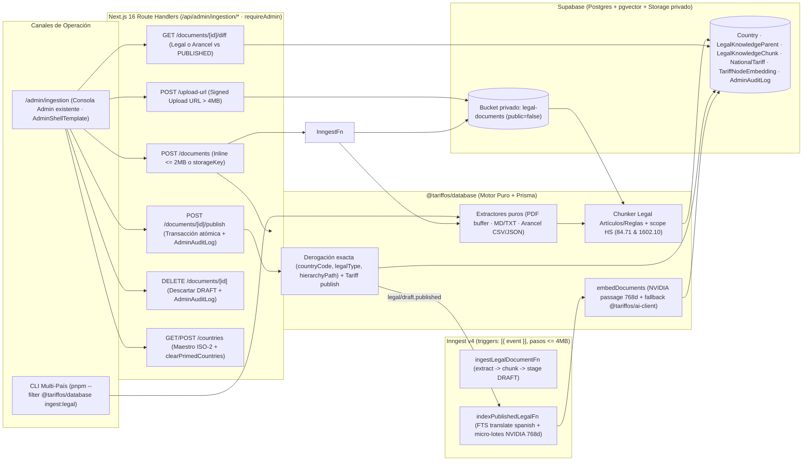

# Plan de Implementación — Pipeline de Ingestión de Documentos Legales y Aranceles (Venezuela First · Multi-País)

> **Modo de Ejecución:** Plan **Implementation-Ready** diseñado para ejecutarse fase por fase con **Neon** (lógica compleja, parsers, transacciones Prisma/SQL, Inngest v4, APIs, organisms) y **Hydrogen** (contratos Zod, permisos RBAC, atoms/molecules simples, wiring de navegación y CLI). **Ninguna fase deja decisiones abiertas al implementador.**

Este plan diseña e implementa un pipeline **multi-país en arquitectura, arrancando con Venezuela (`VE`) como primer país operativo y configuración por defecto** (Decreto N° 4.944 / GOE N° 6.804, Consolidado Arancel 2026, nomenclatura de 10 dígitos `4.2.2.2`, Ley Orgánica de Aduanas, notas de sección/capítulo/subpartida, exoneraciones y providencias SENIAT). Permite cargar **documentos legales** (PDF, Markdown, TXT) y **aranceles nacionales** (JSON / CSV) en TariffOS v3 cumpliendo estrictamente las reglas del monorepo.

---

## 0. Contrato Obligatorio para Agentes Ejecutores (`Neon` / `Hydrogen`)

1. **Strict TDD (`Red → Green → Refactor`):** Antes de crear o editar cualquier archivo de implementación, escribir el test en Vitest, verificar que falla, implementar solo lo mínimo para pasarlo y refactorizar.
2. **Límite de tamaño (`scripts/check.mjs`):** Objetivo **`<= 180` LOC** por archivo `.ts/.tsx` no-test (`> 200` emite WARN, `> 300` falla el build). Si un archivo se acerca a 180 líneas, dividir en helper puro antes de seguir.
3. **TypeScript estricto:** Cero `any` en código no-test (usar `unknown` + Zod o `Prisma.TransactionClient`). Cero números mágicos inline (usar constantes nombradas).
4. **Package manager exclusivo:** Solo `pnpm` y `pnpm exec tsx`. Prohibido `npm`, `npx`, `yarn`, `bun`.
5. **Sin cambios destructivos a Prisma:** Reutilizamos `Country`, `LegalKnowledgeParent`, `LegalKnowledgeChunk`, `NationalTariff`, `TariffNodeEmbedding` y `AdminAuditLog` ya existentes en [schema.prisma](file:///Users/afernandez/projects/tariffos-v3/packages/database/prisma/schema.prisma). Si alguna tarea tocara `packages/database/prisma/**`, aplicar Regla #9 (`RLS` + `pnpm check:db`).
6. **Seguridad Admin:** Toda ruta `/api/admin/ingestion/*` usa `requireAdmin('ingestion:read' | 'ingestion:manage')` de [http-helpers.ts](file:///Users/afernandez/projects/tariffos-v3/apps/web/src/lib/admin/http-helpers.ts) — **NUNCA** `resolveCloudTenantContext` (que es sesión de tenant cliente). Toda mutación registra auditoría con `recordAdminAudit` (cloud) y `appendOfflineAudit` (offline).
7. **Verificación obligatoria:** Correr `pnpm check:quick` tras cada sub-paso y `pnpm check` al cerrar cada fase. Al cerrar Fase 5 y Fase 6, confirmar también `pnpm --filter web build`.

### Guía Rápida de Asignación de Modelos

| Modelo | Alcance ideal | Fases / Pasos asignados |
| :--- | :--- | :--- |
| **`[Hydrogen]`** | Contratos Zod, enums RBAC, atoms/molecules sin estado complejo, enlace en sidebar, CLI wrapper y scripts `package.json`. | `1.1`, `1.2`, `5.1`, `5.2`, `5.3`, `5.5`, `6.1` |
| **`[Neon]`** | Parsers PDF/CSV/JSON, chunker legal, diff engine, transacciones Prisma + derogación + SQL FTS/vector, `prisma-ports.ts`, Inngest v4, APIs REST + Signed Upload URL, organism workspace y tests de integración. | `2.1`, `2.2`, `2.3`, `2.4`, `2.5`, `2.6`, `2.7`, `3.1`, `3.2`, `4.1`, `4.2`, `4.3`, `4.4`, `5.4`, `5.6` |

---

## 1. Arquitectura Objetivo End-to-End



### Decisiones Técnicas Cerradas (No Re-diseñar)

1. **Enfoque Venezuela First (`VE`):**
   - `VE` viene pre-seleccionado por defecto en `/admin/ingestion`, APIs y CLI (`--country VE`), pero **toda regla de formato/dígitos se lee desde `Country`** (`nomenclatureDigits`, `codeGrouping`, `legislation`) vía [country.ts](file:///Users/afernandez/projects/tariffos-v3/packages/database/src/country.ts).
   - Presets de `hierarchyPath` en UI para VE: `SEC-I`..`SEC-XXI`, capítulos `01`..`98`, `loa`, `decreto-4944`, `seniat`, `exoneraciones`, `arancel`.
2. **Derogación Segura Exacta (fix a `derogation.ts`):**
   - `sunsetOverlappingRecords` **NUNCA** usa `startsWith`. Exige `hierarchyPath.trim().length > 0` y filtra por igualdad exacta:
     `{ id: { not: draftId }, countryCode, legalType, hierarchyPath, status: 'PUBLISHED', isDerogated: false, validFromDate: { lte: validFromDate } }`.
   - Marca solo esos registros con `{ isDerogated: true, status: 'DEROGATED', validToDate: new Date(validFromDate.getTime() - 1) }`.
3. **Resolución de Colisión `@@unique([countryCode, legalType, hierarchyPath, validFromDate])` sin migrar esquema:**
   - Al ejecutar `stageLegalDocumentDraft`:
     - Si ya existe un `DRAFT` con esa tupla exacta, se actualiza el `DRAFT` existente reemplazando sus chunks.
     - Si existe un registro `PUBLISHED` o `DEROGATED` con exactamente la misma `validFromDate`: si `replaceSameDate !== true`, lanzar error tipado `DraftDateCollisionError` (HTTP `409`); si `replaceSameDate === true`, avanzar `validFromDate` en `+1000ms` (reintentando hasta encontrar timestamp libre en el mismo día) para que el `DRAFT` coexista durante el preview de Diff y, al publicarse, derogue al anterior con `validToDate = newValidFromDate - 1ms`.
4. **Staging y Diff de Aranceles (`TARIFF_SCHEDULE`) sin romper `NationalTariff`:**
   - `NationalTariff` no tiene columna `status` y tiene `@@unique([countryCode, hsCode])`. Por lo tanto, los lotes `tariff_json` / `tariff_csv` se guardan en staging como `LegalKnowledgeParent` con `legalType: 'TARIFF_SCHEDULE'`, `hierarchyPath: 'arancel'`, `status: 'DRAFT'` y `content: JSON.stringify(normalizedTariffPayload)` (o referencia a `storageKey` si excede 2 MB).
   - El Diff compara los rows staged contra `NationalTariff` activo (`isActive: true, isDerogated: false`) del país (altas, bajas, cambios de `adValorem`, `iva`, `isBK`, `isBIT`, `legalNotes`, `description`).
   - Al publicar un `TARIFF_SCHEDULE`, dentro de una transacción Prisma: se hace `upsert` de todas las partidas staged en `NationalTariff`, se marcan las partidas removidas como `{ isActive: false, isDerogated: true, validToDate: derogationDate }`, se actualiza `Country.datasetVersion`, se llama a `clearPrimedCountries()`, se deroga el `TARIFF_SCHEDULE` previo y se dispara `legal/draft.published` con `kind: 'tariff'` para re-embedding incremental en `TariffNodeEmbedding` (idéntico al modo `--sync` de [embed_tariff_nodes.ts](file:///Users/afernandez/projects/tariffos-v3/packages/database/src/scripts/embed_tariff_nodes.ts)).
5. **Embeddings y FTS 100% alineados con producción:**
   - **FTS:** Siempre usar `to_tsvector('spanish', translate(coalesce("heading", '') || ' ' || "content", 'áéíóúüñÁÉÍÓÚÜÑ', 'aeiouunAEIOUUN'))` — idéntico a [extract_arancel_notes.ts](file:///Users/afernandez/projects/tariffos-v3/packages/database/src/scripts/extract_arancel_notes.ts#L590) y [tariff-fts.ts](file:///Users/afernandez/projects/tariffos-v3/apps/web/src/lib/agent/tariff-fts.ts#L98).
   - **Vectores:** Promover `embedDocuments` de [packages/database/src/scripts/embeddings.ts](file:///Users/afernandez/projects/tariffos-v3/packages/database/src/scripts/embeddings.ts) a módulo compartido `packages/database/src/ingestion/embeddings.ts` (`nvidia/nemotron-3.5-embed-1b`, `input_type: 'passage'`, `dimensions: 768` + fallback a `@tariffos/ai-client`) para coincidir con [tariff-vector.ts](file:///Users/afernandez/projects/tariffos-v3/apps/web/src/lib/agent/tariff-vector.ts).
   - **Ahorro de cuota:** `SECTION` y `CHAPTER` se recuperan por filtro duro + FTS (no generan embeddings salvo que se pase `forceEmbeddings: true`); `LEGAL_NOTE`, `EXEMPTION` y `TARIFF_SCHEDULE` sí generan embeddings en micro-lotes (`BATCH = 20`).
6. **Subida de PDFs grandes (`> 4 MB`) en Vercel:**
   - Gacetas oficiales y el Arancel Consolidado pesan 15–50 MB (Vercel corta payloads en 4.5 MB). En modo `cloud`, el cliente solicita una Signed Upload URL a `POST /api/admin/ingestion/upload-url`, sube el binario directo al bucket privado `legal-documents` (`public = false`) en Supabase Storage, y luego envía solo `{ storageKey, ...metadata }` a `POST /api/admin/ingestion/documents`.
7. **Unificación de `pdfjs-dist`:**
   - Mover `pdfjs-dist` de `devDependencies` a `dependencies` en [packages/database/package.json](file:///Users/afernandez/projects/tariffos-v3/packages/database/package.json) alineado a la misma versión de [apps/web/package.json](file:///Users/afernandez/projects/tariffos-v3/apps/web/package.json) (`^4.10.38`) y agregar `serverExternalPackages: ['pdfjs-dist']` en [apps/web/next.config.ts](file:///Users/afernandez/projects/tariffos-v3/apps/web/next.config.ts).

---

## 2. Fases de Ejecución Detalladas (Strict TDD)

### Fase 1 — Contratos Compartidos y Permisos RBAC (`@tariffos/shared-types` + `apps/web`)

#### Paso 1.1 `[Hydrogen]` — Esquemas Zod de Ingestión Legal y Arancelaria
- **Test primero:** `packages/shared-types/src/__tests__/legal-ingestion.test.ts`
  - Casos: validar formatos (`pdf`, `markdown`, `txt`, `tariff_json`, `tariff_csv`), rechazar `countryCode` != 2 letras mayúsculas, validar `codeGrouping` coherente con `nomenclatureDigits` (ej. `4.2.2.2` suma `10`, rechazar `4.2.2` con `10`), validar `LegalDocumentUploadInputSchema` (requiere `content` o `storageKey`), validar `LegalDraftDiffSchema` y `TariffDraftDiffSchema`.
- **Implementación (`<= 180` LOC):** `packages/shared-types/src/legal-ingestion.ts` + export `export * from './legal-ingestion.js';` en [packages/shared-types/src/index.ts](file:///Users/afernandez/projects/tariffos-v3/packages/shared-types/src/index.ts).
  - Exports exactos:
    - `LegalDocumentTypeSchema`: `z.enum(['SECTION', 'CHAPTER', 'SUBHEADING', 'LEGAL_NOTE', 'EXEMPTION', 'TARIFF_SCHEDULE'])`
    - `LegalDocumentStatusSchema`: `z.enum(['DRAFT', 'PUBLISHED', 'DEROGATED'])`
    - `IngestionSourceFormatSchema`: `z.enum(['pdf', 'markdown', 'txt', 'tariff_json', 'tariff_csv'])`
    - `CountryConfigInputSchema`: `{ code: ISO-2 uppercase, name, legislation, nomenclatureDigits: int 6..12, codeGrouping, datasetVersion?: string, isActive?: boolean }` con `.refine()` validando suma de dígitos.
    - `CountryIngestionSummarySchema`: campos de `Country` + `{ publishedDocuments, draftDocuments, derogatedDocuments, activeTariffs, embeddedTariffs }`.
    - `LegalDocumentUploadInputSchema`: `{ countryCode (default 'VE'), legalType, hierarchyPath, title, sourceFormat, sourceFile?, officialDocumentNumber?, decreeNumber?, validFromDate (ISO date/datetime), replaceSameDate (default false), content?, storageKey? }`.
    - `SignedUploadRequestSchema` & `SignedUploadResponseSchema`.
    - `LegalDraftSummarySchema`, `LegalDraftDiffSchema`, `TariffRowChangeSchema`, `PublishDraftResultSchema`.
- **Verificación:** `pnpm --filter @tariffos/shared-types test && pnpm check:quick`

#### Paso 1.2 `[Hydrogen]` — Permisos RBAC `ingestion:read` e `ingestion:manage`
- **Test primero:** Actualizar [apps/web/src/lib/admin/permissions.test.ts](file:///Users/afernandez/projects/tariffos-v3/apps/web/src/lib/admin/permissions.test.ts) para verificar: `support` y `ops_billing` tienen `ingestion:read` pero NO `ingestion:manage`; `super_admin` tiene ambos; `user` ninguno.
- **Implementación:**
  - Añadir `'ingestion:read'` y `'ingestion:manage'` a `AdminPermissionSchema` en [packages/shared-types/src/admin.ts](file:///Users/afernandez/projects/tariffos-v3/packages/shared-types/src/admin.ts).
  - Añadir ambos permisos a `ALL_PERMISSIONS` y `ROLE_PERMISSIONS` en [apps/web/src/lib/admin/permissions.ts](file:///Users/afernandez/projects/tariffos-v3/apps/web/src/lib/admin/permissions.ts).
- **Verificación:** `pnpm --filter web test src/lib/admin/permissions.test.ts && pnpm check`

---

### Fase 2 — Motor Puro de Parsing, Chunking, Diff, Derogación y Retrieval (`@tariffos/database` + `apps/web`)

Todos los archivos nuevos viven en `packages/database/src/ingestion/` (`<= 180` LOC c/u, cero `any`), exportados en [packages/database/src/index.ts](file:///Users/afernandez/projects/tariffos-v3/packages/database/src/index.ts).

#### Paso 2.1 `[Neon]` — Alinear `pdfjs-dist` + Extractor PDF Puro (`pdf-extractor.ts`)
- **Infraestructura previa:**
  - En [packages/database/package.json](file:///Users/afernandez/projects/tariffos-v3/packages/database/package.json), mover `"pdfjs-dist": "^4.10.38"` a `dependencies` (misma versión que `apps/web`).
  - En [apps/web/next.config.ts](file:///Users/afernandez/projects/tariffos-v3/apps/web/next.config.ts), configurar `serverExternalPackages: ['pdfjs-dist']`.
  - Ejecutar `pnpm install`.
- **Test primero:** `packages/database/src/__tests__/pdf-extractor.test.ts` (mocking `pdfjs-dist/legacy/build/pdf.mjs` para probar normalización de espacios, eliminación de cabeceras/pies repetitivos en `>= 3` páginas, y separación `\n\f\n`).
- **Implementación (`<= 150` LOC):** `packages/database/src/ingestion/pdf-extractor.ts`
  - Exports: `extractPdfTextFromBuffer(bytes: Uint8Array): Promise<{ text: string; pageCount: number }>`, `stripRepeatedPageHeadersFooters(pages: string[]): string[]`.
  - Mantener [packages/database/src/scripts/pdf-text.ts](file:///Users/afernandez/projects/tariffos-v3/packages/database/src/scripts/pdf-text.ts) intacto o delegando a `extractPdfTextFromBuffer`.
- **Verificación:** `pnpm --filter @tariffos/database test src/__tests__/pdf-extractor.test.ts && pnpm check:quick`

#### Paso 2.2 `[Neon]` — Chunker Legal Determinista y Extractor de `scope` HS (`legal-chunker.ts`)
- **Test primero:** `packages/database/src/__tests__/legal-chunker.test.ts`
  - Fixtures reales venezolanos:
    1. Artículos LOA (`Artículo 1°`, `Art. 25`) preservando parágrafos.
    2. Notas de Capítulo Decreto 4.944 (`1.`, `2.` manteniendo sub-incisos `a)`, `b)`, `c)` en el mismo chunk).
    3. Secciones Markdown (`#`, `##`, `###`).
    4. Extracción de `scope` capturando **ambas** notaciones: `"84.71"`, `"21.06.90"`, `"1602.10"`, `"8517.62.91.00"` (deduplicadas y normalizadas sin ruido de fechas o artículos).
- **Implementación (`<= 180` LOC):** `packages/database/src/ingestion/legal-chunker.ts`
  - Exports:
    - `HS_SCOPE_REF_RE = /\b(?:\d{4}(?:\.\d{2}){1,3}|\d{2}(?:\.\d{2}){1,4})\b/g`
    - `extractHsScopeCodes(text: string): string[]` (retorna códigos normalizados, excluyendo años `19xx`/`20xx` sueltos y números de gaceta).
    - `chunkLegalDocument(input: { title: string; content: string; format: 'pdf' | 'markdown' | 'txt' }): LegalChunkDraft[]` donde `LegalChunkDraft = { heading: string; ruleNumber: string | null; content: string; scope: string[]; chunkIndex: number }`.
- **Verificación:** `pnpm --filter @tariffos/database test src/__tests__/legal-chunker.test.ts && pnpm check:quick`

#### Paso 2.3 `[Neon]` — Parser Multi-País de Aranceles Tabulares CSV/JSON (`tariff-parser.ts`)
- **Test primero:** `packages/database/src/__tests__/tariff-parser.test.ts`
  - Casos: CSV con comas escapadas y BOM UTF-8; JSON en formato plano y en formato `ArancelArtifact` (`arancel-2026.rows.json`); validación estricta contra `CountryRecord` (`VE` 10 dígitos `4.2.2.2` y un segundo país ficticio `MX` 8 dígitos `4.2.2`); parseo de `BK`/`BIT` en `adValorem`/`aec`; rechazo de filas con dígitos inválidos o tasas negativas; composición de documento ancestral usando `ancestryOf` y `composeDocument` de [arancel-tree.ts](file:///Users/afernandez/projects/tariffos-v3/packages/database/src/arancel-tree.ts) y `nationalDigits` / `formatNationalCode` de [country.ts](file:///Users/afernandez/projects/tariffos-v3/packages/database/src/country.ts).
- **Implementación (`<= 190` LOC):** `packages/database/src/ingestion/tariff-parser.ts`
  - Exports: `NormalizedTariffRow`, `parseTariffSchedule(raw: string, format: 'tariff_csv' | 'tariff_json', country: Pick<CountryRecord, 'code' | 'nomenclatureDigits' | 'codeGrouping'>): { rows: NormalizedTariffRow[]; leafCount: number; errors: string[] }`.
- **Verificación:** `pnpm --filter @tariffos/database test src/__tests__/tariff-parser.test.ts && pnpm check:quick`

#### Paso 2.4 `[Neon]` — Motor de Diff Legal y Arancelario (`diff-engine.ts`)
- **Test primero:** `packages/database/src/__tests__/diff-engine.test.ts`
  - Casos:
    1. Diff legal (`computeLegalChunksDiff`): detecta chunks agregados, modificados, eliminados y unión de códigos HS en `scope`.
    2. Diff arancelario (`computeTariffRowsDiff`): detecta partidas agregadas, derogadas/eliminadas y cambios por campo (`adValorem`, `iva`, `description`, `legalNotes`, `isBK`, `isBIT`), devolviendo conteos totales + muestra acotada (`MAX_DIFF_SAMPLE = 50`).
- **Implementación (`<= 170` LOC):** `packages/database/src/ingestion/diff-engine.ts` (100% puro, sin DB).
- **Verificación:** `pnpm --filter @tariffos/database test src/__tests__/diff-engine.test.ts && pnpm check:quick`

#### Paso 2.5 `[Neon]` — Refactor Tipado de `derogation.ts` + Promoción de `embeddings.ts` + Servicio de Ciclo de Vida (`lifecycle-service.ts`)
- **Test primero:** `packages/database/src/__tests__/lifecycle-service.test.ts`
  - Casos críticos (con mock de `PrismaClient` / `$transaction`):
    1. `sunsetOverlappingRecords` lanza error si `hierarchyPath` está vacío y **SOLO** deroga registros con igualdad exacta `(countryCode, legalType, hierarchyPath)` y `validFromDate <= newValidFromDate` (nunca `startsWith`).
    2. `stageLegalDocumentDraft` crea `DRAFT` + chunks; si existe `DRAFT` con misma clave única lo reemplaza; si existe `PUBLISHED` con misma `validFromDate` lanza `DraftDateCollisionError` salvo `replaceSameDate: true` (que suma `+1000ms`).
    3. `publishLegalDraft` rechaza si `status !== 'DRAFT'`, ejecuta derogación + promoción a `PUBLISHED` en `$transaction`; si `legalType === 'TARIFF_SCHEDULE'`, aplica upsert masivo + derogación de códigos ausentes en `NationalTariff` + `clearPrimedCountries()`.
    4. `discardLegalDraft` rechaza borrar `PUBLISHED` o `DEROGATED` (solo `DRAFT`).
    5. `populateChunkSearchVectors` ejecuta SQL con `to_tsvector('spanish', translate(..., 'áéíóúüñÁÉÍÓÚÜÑ', 'aeiouunAEIOUUN'))`.
- **Implementación:**
  - Refactorizar [packages/database/src/derogation.ts](file:///Users/afernandez/projects/tariffos-v3/packages/database/src/derogation.ts) (`<= 80` LOC, cero `any`, firma `sunsetOverlappingRecords(tx, { draftId, countryCode, legalType, hierarchyPath, validFromDate })`).
  - Mover/promover `embedDocuments`, `embeddingModel`, `embeddingDims` a `packages/database/src/ingestion/embeddings.ts` (`<= 95` LOC) y dejar [packages/database/src/scripts/embeddings.ts](file:///Users/afernandez/projects/tariffos-v3/packages/database/src/scripts/embeddings.ts) como re-export para los scripts existentes.
  - Crear `packages/database/src/ingestion/lifecycle-service.ts` (`<= 195` LOC) + si hace falta separar publicación arancelaria, crear `packages/database/src/ingestion/tariff-publish.ts` (`<= 140` LOC) para respetar `<= 200` LOC holgadamente.
  - Exportar todo desde [packages/database/src/index.ts](file:///Users/afernandez/projects/tariffos-v3/packages/database/src/index.ts).
- **Verificación:** `pnpm --filter @tariffos/database test && pnpm check:quick`

#### Paso 2.6 `[Neon]` — Blindar `getLegalNotes` en el Clasificador (`apps/web/src/lib/agent/prisma-ports.ts`)
- **Test primero:** `apps/web/src/lib/agent/__tests__/prisma-ports-legal.test.ts`
  - Verificar que `getLegalNotes('VE', '8517.62.91.00')`:
    1. Filtra estrictamente `parent: { countryCode: 'VE', status: 'PUBLISHED', isDerogated: false, validFromDate: { lte: now }, OR: [{ validToDate: null }, { validToDate: { gte: now } }] }`.
    2. Incluye tanto notas estructurales (`hierarchyPath IN ['85', 'SEC-XVI']`) como chunks transversales (`loa`, `exoneraciones`) cuyo `scope` coincida con `['85.17', '8517', '8517.62', '8517.62.91', '8517.62.91.00']`.
    3. Aplica `orderBy: [{ chunkIndex: 'asc' }, { id: 'asc' }]` determinista.
- **Implementación:** Actualizar `getLegalNotes` en [apps/web/src/lib/agent/prisma-ports.ts](file:///Users/afernandez/projects/tariffos-v3/apps/web/src/lib/agent/prisma-ports.ts#L68-L97) manteniendo el archivo `<= 190` LOC (extraer helper `buildHsScopeVariants` si pasa de 180 líneas).
- **Verificación:** `pnpm --filter web test src/lib/agent && pnpm check` (cierre de Fase 2 en verde).

---

### Fase 3 — Pipeline Durable en Inngest v4 (`apps/web/src/lib/inngest/`)

> **Regla Inngest v4:** Usar `triggers: [{ event: '...' }]` igual que [functions.ts](file:///Users/afernandez/projects/tariffos-v3/apps/web/src/lib/inngest/functions.ts#L43-L56). **Nunca** retornar el texto completo del PDF ni arrays de vectores entre `step.run(...)` (límite 4 MB por step).

#### Paso 3.1 `[Neon]` — `ingestLegalDocumentFn` (evento `legal/document.uploaded`)
- **Test primero:** `apps/web/src/lib/inngest/legal-ingestion-helpers.test.ts` (probar helpers puros de resolución de fuente inline vs Storage, despacho legal vs arancel y partición en lotes de IDs).
- **Implementación (`<= 160` LOC):** `apps/web/src/lib/inngest/legal-ingestion-fn.ts`
  - Config: `id: 'ingest-legal-document'`, `retries: 2`, `concurrency: [{ limit: 2, key: 'event.data.countryCode' }]`, `triggers: [{ event: 'legal/document.uploaded' }]`.
  - `step.run('extract-and-stage-draft')`: descarga bytes desde Supabase Storage (`createSupabaseAdminClient().storage.from('legal-documents').download(storageKey)`) si existe `storageKey`, extrae texto (`extractPdfTextFromBuffer` si PDF), parsea (legal o arancel) y llama `stageLegalDocumentDraft`. Retorna solo `{ parentId, chunkCount, status: 'DRAFT' }`.
- **Verificación:** `pnpm --filter web test src/lib/inngest/legal-ingestion-helpers.test.ts && pnpm check:quick`

#### Paso 3.2 `[Neon]` — `indexPublishedLegalFn` (evento `legal/draft.published`)
- **Implementación (`<= 175` LOC):** `apps/web/src/lib/inngest/legal-indexing-fn.ts`
  - Config: `id: 'index-published-legal'`, `retries: 3`, `concurrency: [{ limit: 2, key: 'event.data.countryCode' }]`, `throttle: { limit: 60, period: '1m' }`, `triggers: [{ event: 'legal/draft.published' }]`.
  - Si `kind === 'legal'`:
    1. `step.run('update-fts-tsvector')`: ejecuta `populateChunkSearchVectors(prisma, parentId)`.
    2. Si `legalType` es `SECTION` o `CHAPTER` y `!forceEmbeddings`, termina aquí (0 costo de API).
    3. Si `legalType` es `LEGAL_NOTE` o `EXEMPTION` (o `forceEmbeddings`): lee lista de `chunkIds` sin embedding en `step.run('list-pending-chunks')`, y para cada micro-lote (`BATCH = 20`) ejecuta `step.run(\`embed-legal-batch-\${idx}\`)` llamando a `embedDocuments` y haciendo `UPDATE "LegalKnowledgeChunk" SET embedding = ...::vector` dentro del mismo step (retorna solo `{ embedded }`).
  - Si `kind === 'tariff'`:
    1. `step.run('compute-pending-tariff-embeddings')`: calcula nodos `NationalTariff` de `nomenclatureDigits` dígitos cuyo documento compuesto (`ancestryOf` + `composeDocument`) cambió o no existe en `TariffNodeEmbedding` y elimina los obsoletos (`--sync`). Retorna solo lista de `hsCodes` pendientes (strings cortos).
    2. Por cada micro-lote (`BATCH = 20`), `step.run(\`embed-tariff-batch-\${idx}\`)`: compone documentos, llama `embedDocuments` (`NVIDIA passage 768d`) y hace `INSERT ... ON CONFLICT ("countryCode", "hsCode") DO UPDATE` en `TariffNodeEmbedding`.
- **Registro:** Exportar `ingestLegalDocumentFn` e `indexPublishedLegalFn` en el array `inngestFunctions` de [apps/web/src/lib/inngest/functions.ts](file:///Users/afernandez/projects/tariffos-v3/apps/web/src/lib/inngest/functions.ts#L195) (esto los registra automáticamente en [apps/web/src/app/api/inngest/route.ts](file:///Users/afernandez/projects/tariffos-v3/apps/web/src/app/api/inngest/route.ts)).
- **Verificación:** `pnpm check` (cierre de Fase 3 en verde).

---

### Fase 4 — API REST Admin Protegida y Store Offline (`apps/web/src/app/api/admin/ingestion/`)

Seguir exactamente el patrón de [apps/web/src/app/api/admin/plans/route.ts](file:///Users/afernandez/projects/tariffos-v3/apps/web/src/app/api/admin/plans/route.ts): `requireAdmin(...)`, `isCloudModeEnabled()`, `recordAdminAudit` (cloud) / `appendOfflineAudit` (offline).

#### Paso 4.1 `[Neon]` — Store Offline de Ingestión (`apps/web/src/lib/admin/ingestion-offline-store.ts`)
- **Implementación (`<= 180` LOC):** Mantener el estado offline de ingestión separado de [offline-store.ts](file:///Users/afernandez/projects/tariffos-v3/apps/web/src/lib/admin/offline-store.ts) (para no inflarlo) usando `globalThis.__tariffosOfflineIngestionState`, pre-poblado con `VE` (`Decreto N° 4.944 / GOE N° 6.804`, `10` dígitos, `4.2.2.2`), 1 documento `PUBLISHED` de ejemplo (LOA / Cap. 85) y 1 `DRAFT` listo para probar Diff y Publish sin red.

#### Paso 4.2 `[Neon]` — Endpoints `countries` y `upload-url`
- **`apps/web/src/app/api/admin/ingestion/countries/route.ts` (`<= 140` LOC):**
  - `GET`: `requireAdmin('ingestion:read')` — lista países con conteos reales (`LegalKnowledgeParent` por estado, `NationalTariff` activos, `TariffNodeEmbedding`). `VE` ordenado primero.
  - `POST`: `requireAdmin('ingestion:manage')` — valida con `CountryConfigInputSchema`, crea/actualiza `Country`, llama `primeCountry(...)`, registra `recordAdminAudit(..., action: 'ingestion.country_upserted')`.
- **`apps/web/src/app/api/admin/ingestion/upload-url/route.ts` (`<= 95` LOC):**
  - `POST`: `requireAdmin('ingestion:manage')` — valida `SignedUploadRequestSchema` (máximo `50 MB`). En modo `offline`, responde `{ mode: 'offline', directInline: true }`. En modo `cloud`, genera `storageKey = \`\${countryCode}/\${Date.now()}-\${safeName}\`` y retorna `createSignedUploadUrl` del bucket privado `legal-documents` vía `createSupabaseAdminClient()`.

#### Paso 4.3 `[Neon]` — Endpoints `documents` (`GET`/`POST`) y `documents/[id]` (`DELETE`)
- **`apps/web/src/app/api/admin/ingestion/documents/route.ts` (`<= 180` LOC):**
  - `GET`: `requireAdmin('ingestion:read')` — filtra por `?countryCode=VE&status=DRAFT|PUBLISHED|DEROGATED`.
  - `POST`: `requireAdmin('ingestion:manage')` — acepta JSON (`LegalDocumentUploadInputSchema`) o `multipart/form-data` para archivos pequeños (`<= 2 MB`).
    - Si viene `storageKey` o archivo PDF pesado en `cloud`: encola `inngest.send({ name: 'legal/document.uploaded', data: ... })` y retorna `202 Accepted`.
    - Si viene contenido inline (`markdown`/`txt`/`tariff_csv`/`tariff_json` `<= 2 MB`): ejecuta extracción + chunking + `stageLegalDocumentDraft` síncronamente, registra `recordAdminAudit(..., action: 'ingestion.draft_staged')` y retorna `201 Created`.
- **`apps/web/src/app/api/admin/ingestion/documents/[id]/route.ts` (`<= 95` LOC):**
  - `DELETE`: `requireAdmin('ingestion:manage')` — llama `discardLegalDraft(prisma, id)` (solo `DRAFT`), registra `recordAdminAudit(..., action: 'ingestion.draft_discarded')`.

#### Paso 4.4 `[Neon]` — Endpoints `documents/[id]/diff` (`GET`) y `documents/[id]/publish` (`POST`) + Tests API
- **`apps/web/src/app/api/admin/ingestion/documents/[id]/diff/route.ts` (`<= 110` LOC):**
  - `GET`: `requireAdmin('ingestion:read')` — devuelve `LegalDraftDiff` o `TariffDraftDiff` contra los registros `PUBLISHED` vigentes del mismo país.
- **`apps/web/src/app/api/admin/ingestion/documents/[id]/publish/route.ts` (`<= 130` LOC):**
  - `POST`: `requireAdmin('ingestion:manage')` — ejecuta `publishLegalDraft(prisma, id)` + `recordAdminAudit(..., action: 'ingestion.draft_published')` y en modo `cloud` emite `inngest.send({ name: 'legal/draft.published', data: { parentId, countryCode, legalType, kind } })`.
- **Tests:** `apps/web/src/app/api/admin/ingestion/__tests__/ingestion-api.test.ts`
  - Cubrir: `401/403` sin rol admin, `403` cuando `support` intenta `POST`/`DELETE`, alta de país (`CO`), carga de `DRAFT` legal + `GET /diff` + `POST /publish` + verificación de derogación del documento anterior + `DELETE` rechazado sobre `PUBLISHED` + entrada en `auditLogs`.
- **Verificación:** `pnpm --filter web test src/app/api/admin/ingestion && pnpm check` (cierre de Fase 4 en verde).

---

### Fase 5 — Panel Admin `/admin/ingestion` Integrado en Consola Admin (`<= 180` LOC por archivo)

Ubicar en `apps/web/src/components/admin/` y `apps/web/src/lib/admin/` para integrarse nativamente con [AdminShellTemplate.tsx](file:///Users/afernandez/projects/tariffos-v3/apps/web/src/components/admin/templates/AdminShellTemplate.tsx) y [AdminKpiTile.tsx](file:///Users/afernandez/projects/tariffos-v3/apps/web/src/components/admin/atoms/AdminKpiTile.tsx).

#### Paso 5.1 `[Hydrogen]` — Puerto HTTP Frontend (`apps/web/src/lib/admin/ingestion-port.ts`, `<= 150` LOC)
- Definir interfaz `IIngestionAdminPort` (`listCountries`, `createCountry`, `listDocuments`, `requestUploadUrl`, `uploadDocument`, `getDraftDiff`, `publishDraft`, `discardDraft`) y `createHttpIngestionAdminPort()` apuntando a `/api/admin/ingestion/*` (si el archivo supera 2 MB y el servidor entrega `signedUrl`, realiza `PUT` directo a Supabase Storage y luego `POST /documents` con `storageKey`).

#### Paso 5.2 `[Hydrogen]` — Atom + Navegación Sidebar
- **`apps/web/src/components/admin/atoms/DocumentStatusBadge.tsx` (`<= 60` LOC):** Badges accesibles para `DRAFT` (ámbar), `PUBLISHED` (esmeralda), `DEROGATED` (neutro/rose) + chip discreto de `TARIFF_SCHEDULE` / indexación.
- **Actualizar [AdminSidebarNav.tsx](file:///Users/afernandez/projects/tariffos-v3/apps/web/src/components/admin/molecules/AdminSidebarNav.tsx):** Añadir `{ href: '/admin/ingestion', label: 'Normativa', icon: BookOpen, exact: false }` a `ADMIN_NAV_ITEMS`.

#### Paso 5.3 `[Hydrogen]` — Molecules de Ingestión (`apps/web/src/components/admin/molecules/`, `<= 180` LOC c/u)
- **`CountrySelectorBar.tsx`:** Selector de país (con `VE` pre-seleccionado), badge con `nomenclatureDigits` y `codeGrouping`, más formulario desplegable/modal compacto para registrar un nuevo país ISO-2.
- **`LegalDocumentUploadCard.tsx`:** Dropzone para `.pdf`, `.md`, `.txt`, `.csv`, `.json` (o pegado de texto rápido), presets de `hierarchyPath` para VE (`loa`, `decreto-4944`, `seniat`, `exoneraciones`, `arancel`, `SEC-*`, capítulo `01..98`), tipo legal, decreto, gaceta y fecha de vigencia.
- **`LegalDocumentRowCard.tsx`:** Fila con título, `DocumentStatusBadge`, ruta jerárquica, conteo de chunks, vigencia y botones `Ver Diff / Publicar` y `Descartar` (solo en `DRAFT`).
- **`DraftDiffPreviewModal.tsx`:** Muestra documentos que serán derogados, resumen de chunks (o partidas arancelarias) agregados/modificados/eliminados, chips de `scope` HS y botón **`Publicar y derogar versión anterior`**.

#### Paso 5.4 `[Neon]` — Organism `AdminIngestionWorkspace.tsx` (`<= 195` LOC)
- **`apps/web/src/components/admin/organisms/AdminIngestionWorkspace.tsx`:**
  - Reutiliza `AdminKpiTile` (Publicados, Borradores, Partidas activas, Indexación vectorial), pestañas `Borradores | Publicados | Derogados`, integración con `IIngestionAdminPort` inyectable para tests y refresco inmediato tras subir/publicar/descartar.

#### Paso 5.5 `[Hydrogen]` — Página `/admin/ingestion`
- **`apps/web/src/app/admin/ingestion/page.tsx` (`<= 20` LOC):** Monta `<AdminIngestionWorkspace />` heredando automáticamente el guard RBAC y `AdminShellTemplate` de [apps/web/src/app/admin/layout.tsx](file:///Users/afernandez/projects/tariffos-v3/apps/web/src/app/admin/layout.tsx).

#### Paso 5.6 `[Neon]` — Test de Integración UI
- **`apps/web/src/components/admin/__tests__/AdminIngestionWorkspace.test.tsx`:**
  - Usando `IIngestionAdminPort` inyectado (mock determinista): renderiza con `VE` por defecto, sube documento Markdown, abre `DraftDiffPreviewModal`, muestra el documento a derogar y códigos HS en `scope`, pulsa `Publicar y derogar versión anterior` y verifica transición a pestaña `Publicados`.
- **Verificación:** `pnpm --filter web test src/components/admin && pnpm check && pnpm --filter web build`

---

### Fase 6 — CLI Multi-País Reusable (`packages/database`)

#### Paso 6.1 `[Hydrogen]` — CLI `ingest_legal.ts` y Script `pnpm`
- **Archivo (`<= 175` LOC):** `packages/database/src/scripts/ingest_legal.ts`
  - Reutiliza `extractPdfTextFromBuffer`, `chunkLegalDocument`, `parseTariffSchedule`, `stageLegalDocumentDraft`, `computeDraftDiff`, `publishLegalDraft`, `populateChunkSearchVectors` y `embedDocuments`.
  - Flags: `--country VE` (default `VE`), `--type LEGAL_NOTE|CHAPTER|SECTION|EXEMPTION|TARIFF_SCHEDULE`, `--path <hierarchyPath>`, `--title <title>`, `--decree <decree>`, `--gazette <officialDoc>`, `--valid-from YYYY-MM-DD`, `--file <path>`, `[--replace-same-date]`, `[--publish]`, `[--embed]`, `[--dry-run]`.
- **Script en [packages/database/package.json](file:///Users/afernandez/projects/tariffos-v3/packages/database/package.json):**
  - `"ingest:legal": "pnpm exec tsx src/scripts/ingest_legal.ts"`
- **Ejemplo de uso:**
  ```bash
  pnpm --filter @tariffos/database ingest:legal \
    --country VE --type LEGAL_NOTE --path loa \
    --title "Ley Orgánica de Aduanas" \
    --decree "Gaceta Oficial 6.507" \
    --valid-from 2020-01-29 \
    --file ./docs/laws/ve/loa.pdf \
    --dry-run
  ```
- **Test unitario (`<= 90` LOC):** `packages/database/src/__tests__/ingest-legal-cli.test.ts` (parseo de flags CLI, default `--country VE`, detección de formato por extensión).

---

## 3. Gate Final de Verificación

Al completar la Fase 6, ejecutar en orden y confirmar 100% en verde:
1. `pnpm check` (`tsc --noEmit` en todos los workspaces + `oxlint --type-aware --type-check` + guardrail `<= 200` warn / `<= 300` fail + higiene TS-only + `vitest` completo + `pnpm build:packages`).
2. `pnpm --filter web build` (confirmar que `pdfjs-dist` en `serverExternalPackages` y todas las rutas `/admin/ingestion` y `/api/admin/ingestion/*` compilan limpiamente con Next.js 16 `--webpack`).
3. Verificación manual rápida (o con `next-dev-loop` en modo offline `NEXT_PUBLIC_CLOUD_MODE=false`): abrir `/admin/ingestion`, subir un borrador en `VE`, inspeccionar Diff, publicar y confirmar registro en `/admin/audit`.
