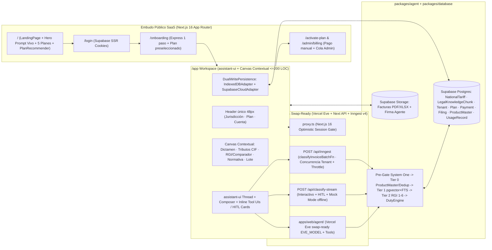

# TariffOS v3 — Plan Maestro Unificado (Clean-Slate + Pipeline Hexagonal + A2UI Baja Fricción + Eve/Inngest)

Este documento es la **única fuente de verdad de implementación** para `/Users/afernandez/projects/tariffos-v3`. Consolida:
1. **Hard Reset sin ataduras:** se descarta todo código heredado de `filings-v2` (o cualquier código que estorbe), **conservando únicamente el micro-harness (`scripts/check.mjs`, `.oxlintrc.jsonc`) y los 23 skills de `.agents/skills/*` (y `.claude/*`)**, además de los esquemas/seeds útiles de `packages/database` y el esqueleto hexagonal de `packages/agent`.
2. **Embudo SaaS completo y monetización** validados en `/Users/afernandez/projects/tariffos-new-mockup` (rama `atomic/batch-manifest-view-extract`).
3. **Contrato A2UI Dinámico (Obligatorios vs. Contextuales) + Revisión Configurable/Invocable por Agente y Skill** con UX de mínima fricción y animaciones fluidas (`framer-motion`).
4. **Arquitectura productiva Next.js 16 + Vercel Eve (*swap-ready*) + `assistant-ui` + Supabase (`pgvector` + Auth + Storage + Realtime) + Inngest v4.**

---

## 1. Qué se Conserva Intacto vs. Qué se Tira

### Inmutable (NO borrar ni degradar)
- **Harness de calidad:** `scripts/check.mjs` (`tsc --noEmit` + `oxlint` + límite de tamaño `<= 200` warn / `300` fail + `vitest`), `.oxlintrc.jsonc`, `pnpm-workspace.yaml`, `skills-lock.json`, `apps/web/AGENTS.md`.
- **Catálogo de Skills (`.agents/skills/*` y `.claude/*`):** conservar los 23 skills instalados y **leer el `SKILL.md` correspondiente antes de ejecutar cada fase**:
  - **Calidad transversal:** `tdd`, `vercel-composition-patterns`, `vercel-react-best-practices`, `vercel-react-view-transitions`.
  - **Datos y Auth (Fase A):** `supabase`, `supabase-postgres-best-practices`.
  - **Dominio y Agente (Fase B):** `venezuela-tariff-classification`, `ai-sdk`, `eve`, `tools`.
  - **Interfaz A2UI y Chat (Fase C):** `assistant-ui`, `runtime`, `primitives`, `thread-list`, `generative-ui`, `elements`, `copilots`.
  - **Lotes Durables (Fase D):** `inngest-setup`, `inngest-events`, `inngest-steps`, `inngest-durable-functions`, `inngest-flow-control`, `inngest-realtime`.

### Descartable / Reemplazable sin contemplaciones
- **Todo `apps/web/src/**` heredado de `filings-v2`** (`__mocks__`, `domain`, `use-cases`, `framework`, `hooks`, `types`, `adapters`, `components/*` viejos, `app/api/chat`, `app/api/extract`, `apps/web/utils/supabase/`, `apps/web/middleware.ts` antiguo).
- **Cualquier código en `packages/*` que contradiga este plan:** puedes refactorizar o reescribir módulos de `packages/agent` o `packages/shared-types` libremente siempre que `pnpm check` quede en verde.

### Lista Negra de `tariffos-new-mockup` (NO portar)
Al portar desde `/Users/afernandez/projects/tariffos-new-mockup`, **NO portes vistas redundantes ya eliminadas o superadas**:
- `TopBar.tsx` (sustituido por header único de `48px` / `h-12`).
- `ExecutiveSummaryCardView.tsx`, `TechnicalSummaryView.tsx`, `ComparativeHistoryReportView.tsx` (sustituidos por apertura directa en `Dictamen` y diff integrado solo cuando `versions >= 2`).
- `firebase.ts`, `FirebaseAuthAdapter.ts`, `FirestoreAdapter.ts`, `server.ts`, `src/server/*` (reemplazados por Supabase + Eve + Route Handlers + Inngest).

---

## 2. Arquitectura Objetivo End-to-End

---

## 3. Contrato A2UI Dinámico y Reglas de Baja Fricción

### 3.1 Componentes Obligatorios vs. Contextuales (Invocados por Agente / Skill)
La interfaz **jamás** monta pestañas vacías ni bloques fijos: renderiza un **núcleo mínimo obligatorio** y activa el resto solo cuando el **Agente / Skill** los emite o el contexto los exige.

| Zona | Componente A2UI | Carácter | Regla de aparición y baja fricción |
| :--- | :--- | :--- | :--- |
| **Chat Inline** | `verdict` | **Obligatorio** (en `classified`) | Código HS clicable para copiar en 1 clic, 3 tiles limpios (`Ad Valorem`, `IVA`, `Régimen`), resumen ejecutivo colapsado por defecto y acciones directas (`Ver Dossier`, `Calcular CIF`, `Exportar PDF`, `Guardar SKU`, `Camino RGI`). |
| **Chat Inline** | `hitl` (`merceological_sheet` / `questionnaire` / `disambiguation`) | **Obligatorio** (en `needs_input`) | Sin banners duplicados. Si hay hipótesis preliminar (`tentativeProposal`), muestra botón **`Usar <hsCode>` en 1 clic**. `Enter` envía en inputs; `questionnaire` con `<= 5` opciones usa **chips clicables de 1 clic**; `disambiguation` numerada (`1`, `2`, `3`). Una vez confirmada, la ficha merceológica se pliega a **1 sola línea**. |
| **Chat Inline** | `legal_notice` | **Contextual** | Si es informativo sin permisos obligatorios y acompaña a un `verdict`, se compacta a **1 sola línea plegable**. Tarjeta completa con checklist solo para `warning`/`restricted` o permisos OGA. |
| **Chat Inline** | `document_summary` | **Contextual** | Solo cuando entran adjuntos (PDF/XLSX/imagen). Compacto con botón directo a `Lote` si es multi-ítem. |
| **Canvas** | `dossier` (**Dictamen**) | **Obligatorio** (individual) | **Pestaña inicial por defecto** al clasificar un ítem. Oculta `OpenArtifactTabsStrip` si solo hay 1 artefacto y oculta historial si `versions < 2`. Auditoría contra `NationalTariff` plegada a 1 línea verde si coincide (se expande sola si hay discrepancia). |
| **Canvas** | `batch_manifest` (**Lote**) | **Obligatorio** (factura/lote) | **Pestaña inicial por defecto** en lotes. Incluye CTA **`Iniciar Triage rápido (N pendientes)`**, **auto-avance** automático al siguiente ítem `needs_review` tras confirmar, y ficha de 7 atributos plegada si ya hay `clarifyingQuestions`. |
| **Canvas** | `calculator` (**Tributos CIF**) | **Contextual** | Arriba del todo van los **3 KPIs vivos** (`Base CIF`, `Total Tributos`, `Costo Nacionalizado`) + los 3 montos (`Valor Factura`, `Flete`, `Seguro` + `Incoterm`). Alícuotas, tasa de cambio y exoneración van en acordeón *"Ajustes avanzados"*. |
| **Canvas** | `rgi_comparator` (**RGI y Comparador**) | **Contextual** | Solo aparece como pestaña si el agente emitió `hierarchy`, `comparison`, pasos RGI o alternativas descartadas (si no, queda como atajo discreto `+ Comparar` a la derecha). |
| **Canvas** | `regulatory_diff` (**Normativa**) | **Contextual** | Solo aparece como pestaña si existen alertas activas para esa partida/jurisdicción o el skill normativo lo invoca (si no, atajo discreto `+ Normativa`). |

### 3.2 Flujo de Revisión y Sellado Configurable + Invocable por el Agente/Skill
El estado `in_review` **NO es un paso fijo obligatorio en la UI**; se gobierna por política + invocación dinámica:
- **Política por Tenant/Perfil (`ApprovalWorkflowMode`):**
  - `'agent_decides'` *(default)*: si la evidencia está completa y verificada, el dictamen nace en `draft_ai` listo para **`Aprobar y sellar` en 1 clic**. Si el Agente o el Skill activo detecta datos faltantes (`unresolved`), alertas `warn`, confianza `< 75%` o invoca explícitamente la tool `request_dossier_review`, el dictamen nace en `in_review` con `AgentReviewTrigger` (`invokedBySkill`, `reason`, `missingFields`).
  - `'direct_seal'`: nace listo para sellar en 1 clic salvo que el agente aduanal humano pulse **`Dejar en revisión`**.
  - `'always_review'`: modo compliance estricto para agencias que exigen doble firma.
- **Control humano siempre disponible:** en el Dictamen coexisten **`Aprobar y sellar`** (1 clic) y **`Dejar en revisión`** (abre nota de duda/documento pendiente del cliente). La firma manuscrita jamás bloquea el onboarding: si falta al exportar el primer PDF, se abre `SignatureQuickModal` en ese instante y se guarda en Supabase Storage.

### 3.3 Descomposición Atómica Obligatoria (`<= 200` líneas por archivo)
`scripts/check.mjs` emite **WARN > 200 líneas** y **FAIL > 300 líneas** en todo archivo `.ts/.tsx` no-test. Al portar desde `tariffos-new-mockup`, divide los monolitos así:
- `src/components/atoms/` — botones, badges, inputs, chips, indicadores de estado, subrayado animado `framer-motion` (`<= 120` LOC c/u).
- `src/components/molecules/` — `VerdictMetricsRow`, `VerdictQuickActions`, `CompactMerceologicalSummary`, `QuickPillField`, `DisambiguationOptionCard`, `CompactLegalNoticeStrip`, `DossierApprovalBar`, `OfficialScheduleAuditBar`, `CifTopKpiStrip`, `PlanCard` (`<= 180` LOC c/u).
- `src/components/organisms/` — `LandingHero` (con prompt vivo), `PricingSection` + `PlanRecommender`, `ExpressOnboardingCard`, `WorkspaceHeader48`, `AssistantThreadSurface`, `DossierView`, `DutyCalculatorView`, `HierarchyTreeView`, `RgiPathAndComparatorView`, `BatchManifestTriageView`, `SignatureQuickModal`, `AdminBillingQueue` (`<= 200` LOC c/u).
- `src/components/templates/` — `PublicMarketingShell`, `WorkspaceSplitShell` (desktop split + mobile `< 1024px` switcher `Chat | Dictamen`).

---

## 4. Plan de Ejecución Estricto Fase por Fase (TDD + `pnpm check`)

> [!IMPORTANT]
> **Regla de Ejecución:** Antes de escribir cualquier implementación en cada sub-tarea, escribe primero el test unitario/integración en Vitest (**Red → Green → Refactor**), mantén cada archivo `<= 200` líneas y ejecuta `pnpm check` al cerrar cada fase. Usa modo offline/mock (`NEXT_PUBLIC_CLOUD_MODE=false` opcional en tests/dev visual) para poder validar toda la UI sin gastar tokens cuando sea necesario.

### Fase 0 — Hard Reset de `apps/web` (Limpieza Total de `filings-v2`)
*Skills a consultar:* `vercel-composition-patterns`.
- [ ] **0.1 Borrar sin excepción el legado de `filings-v2` en `apps/web`:**
  - Eliminar en `apps/web/src/`: `__mocks__/`, `adapters/`, `domain/`, `framework/`, `hooks/`, `types/`, `use-cases/`, todos los componentes heredados en `components/`, `app/api/chat/`, `app/api/extract/`, y los helpers viejos en `lib/` que pertenezcan a `filings-v2`.
  - Eliminar `apps/web/utils/` (cliente Supabase duplicado) y el `apps/web/middleware.ts` viejo (Next.js 16 usa `proxy.ts`; revisar `apps/web/node_modules/next/dist/docs/`).
- [ ] **0.2 Preservar plomería base y tokens visuales:**
  - Conservar `apps/web/AGENTS.md`, `apps/web/next.config.ts` (`withEve`), `postcss.config.mjs`, `tsconfig*.json`, `vitest.*`.
  - Portar los design tokens limpios de `/Users/afernandez/projects/tariffos-new-mockup/src/index.css` a `apps/web/src/app/globals.css` (`Plus Jakarta Sans` + `JetBrains Mono` + variables `--surface-*`, `--ink-*`, `--accent-*`).
  - Dejar un `apps/web/src/app/page.tsx` mínimo temporal y confirmar **`pnpm check:quick` en verde**.

---

### Fase A — Base de Datos Supabase, Auth SSR (`proxy.ts`) y Planes SaaS
*Skills a consultar:* `supabase`, `supabase-postgres-best-practices`, `tdd`, más `apps/web/node_modules/next/dist/docs/`.
- [ ] **A.1 Cliente único de Supabase + `proxy.ts` de Next.js 16:**
  - Crear `apps/web/src/lib/supabase/{client,server,admin}.ts` usando variables estándar (`NEXT_PUBLIC_SUPABASE_URL`, `NEXT_PUBLIC_SUPABASE_ANON_KEY`, `SUPABASE_SERVICE_ROLE_KEY`).
  - Implementar `apps/web/src/proxy.ts` (convención Next.js 16) para refrescar cookies de forma segura y proteger `/app/*`, `/onboarding`, `/activate-plan` y `/admin/*`, dejando públicas `/`, `/login` y `/api/inngest`.
- [ ] **A.2 Esquema Prisma (`@tariffos/database`), `pgvector` y Seeds:**
  - Revisar `packages/database/prisma/schema.prisma` (`Tenant`, `Membership`, `UserProfile`, `Plan`, `Payment`, `NationalTariff`, `TariffNodeEmbedding`, `LegalKnowledgeParent`, `LegalKnowledgeChunk`, `HsPermitRequirement`, `ProductMaster`, `ClassificationSession`, `Filing`, `FilingLine`, `DecisionArtifact`, `UsageRecord`).
  - Añadir/ajustar campos ligeros necesarios en `UserProfile` / `Tenant` / `Payment` (ej. `approvalWorkflowMode`, `defaultIncoterm`, `preferredCurrency`, `detailLevel`, `signatureStorageKey`, referencia/comprobante en `Payment`) sin romper las tablas existentes.
  - Asegurar seed de los **5 planes comerciales** (`trial`, `basico` \$49, `pro` \$299, `enterprise` \$449, `corporate` \$5,900/año `annualOnly`) y verificar los seeds arancelarios (`extracted_tariffs_full.json`, `arancel_rgi.json`, `arancel_legal_articles.json`).
  - Configurar `DualRuntimeConfig` (`NEXT_PUBLIC_CLOUD_MODE` / fallback mock determinista inspirado en `MockAuthPort` y `MockClassificationGateway` del mockup) para que tests y previews locales funcionen sin red.
  - **Cierre de Fase A:** `pnpm check` en verde.

---

### Fase B — Completar `@tariffos/agent` + Costura Swap-Ready de Vercel Eve
*Skills a consultar:* `venezuela-tariff-classification`, `ai-sdk`, `eve`, `tools`, `tdd`.
- [ ] **B.1 Motor de Valoración y Tributos Determinista (`duties.ts`):**
  - Portar con TDD toda la lógica de `/Users/afernandez/projects/tariffos-new-mockup/src/utils/dutyEngine.ts` y `tariffValidator.ts` hacia `packages/agent/src/lib/pipeline/` (`<= 200` LOC por módulo): Incoterms (`EXW`, `FOB`, `CFR`, `CIF`, `DDP`), acuerdos preferenciales, remedios antidumping, exoneraciones y auditoría dígito a dígito contra `NationalTariff`.
- [ ] **B.2 Retrieval Híbrido (`pgvector` + Léxico) y Pre-Gate:**
  - Conectar `PreGate` (System One + `HsPermitRequirement`), `Tier 0` (`ProductMaster` aprobado + `dedup.ts` intra-factura), `Tier 1` (búsqueda híbrida sobre `TariffNodeEmbedding` + FTS en `NationalTariff` y filtro duro de capítulo en `LegalKnowledgeChunk`) y `Tier 2` (razonamiento RGI 1→6 con presupuesto acotado de grounding web: `MAX_WEB_GROUNDING_STANDARD = 12`).
- [ ] **B.3 HITL Merceológico + Política de Revisión Invocable por Agente/Skill:**
  - Implementar en `@tariffos/shared-types` y `@tariffos/agent` los contratos `MerceologicalSheet`, `HitlClarifyingQuestion`, `ApprovalWorkflowMode` (`'agent_decides' | 'direct_seal' | 'always_review'`) y `AgentReviewTrigger` (`invokedBySkill`, `reason`, `missingFields`).
  - Portar y probar `resolveInitialDossierReview` (`dossierApprovalPolicy.ts` del mockup) + exponer la tool `request_dossier_review` para que cualquier agente o skill pueda invocar `in_review` dinámicamente cuando detecte información incompleta o riesgo regulatorio.
- [ ] **B.4 Mapper Puro `A2UI` + Agente Eve Swap-Ready (`apps/web/agent/`):**
  - Crear `mapPayloadToA2UIEnvelope` y `mapBatchToA2UIManifest` respetando estrictamente la separación **Obligatorios vs. Contextuales** de la Sección 3.1 y `preferredCanvasTab: 'dossier'`.
  - Actualizar `apps/web/agent/agent.ts`, `instructions/` y `tools/` para que el modelo sea configurable por entorno (`process.env.EVE_MODEL`) y envuelva los puertos deterministas de `@tariffos/agent`, permitiendo intercambiar el motor del agente sin tocar un solo componente React.
  - **Cierre de Fase B:** `pnpm check` en verde.

---

### Fase C — Construir `apps/web` en Atomic Design: Embudo SaaS + `assistant-ui` + Canvas A2UI
*Skills a consultar:* `assistant-ui`, `runtime`, `primitives`, `thread-list`, `generative-ui`, `elements`, `copilots`, `vercel-react-best-practices`, `vercel-react-view-transitions`, `tdd`.
- [ ] **C.1 Embudo Público, Onboarding Express y Facturación Manual:**
  - `/` (`src/app/page.tsx`): portar en módulos `<= 200` LOC el `LandingPage` del mockup — Hero con **prompt interactivo en vivo** (guarda `pendingQuery` y lo auto-ejecuta al entrar a `/app`), vista previa A2UI, escalera de 5 planes (mensual/anual con `Corporate` solo anual) y `PlanRecommender` interactivo.
  - `/login` (`src/app/login/page.tsx`): Google OAuth + Email/Password con `@supabase/ssr`, preservando `pendingQuery` y `selectedPlanId`.
  - `/onboarding` (`src/app/onboarding/page.tsx`): `OnboardingStepExpress` de **1 solo paso** (nombre, empresa, jurisdicción; preferencias avanzadas plegadas; salta selección de plan si vino preseleccionado desde `/` y provisiona `trial` o crea solicitud pendiente en servidor).
  - `/activate-plan` y `/admin/billing`: flujo manual de reporte de transferencia/Zelle/Pago Móvil/Binance (`IBillingActivationPort` contra `Payment` + Supabase Storage) y cola administrativa de aprobación/rechazo, más `WorkspaceBillingBanner` y `WorkspacePlanStatusCard`.
- [ ] **C.2 Superficie Conversacional con `assistant-ui` + Tool UIs Táctiles:**
  - Header único de `48px` (`WorkspaceHeader48`: sidebar toggle, selector único de Jurisdicción, estado de plan/uso y menú de cuenta/tema).
  - Configurar `AssistantRuntimeProvider` (`@assistant-ui/ai-sdk` / `@assistant-ui/eve`) con `ThreadPrimitive`, `ComposerPrimitive` (adjuntos PDF/XLSX/imagen, cámara, dictado por voz, búsqueda predictiva SKU) y `ThreadListPrimitive` para historial lateral.
  - Implementar las **Inline Tool UIs / HITL Approval Cards** con `framer-motion`:
    - `VerdictCard` (HS clicable para copiar, 3 tiles fiscales, acciones rápidas en 1 clic).
    - `MerceologicalSheetCard` (`Enter` para confirmar, foco en campos faltantes, **1 línea plegada** en `confirmed_summary`) + barra de hipótesis tentativa **`Usar <hsCode>` en 1 clic**.
    - `QuestionnaireCard` (chips de 1 clic cuando `options.length <= 5`, contador vivo `X/N`), `DisambiguationCard` numerada y `LegalNoticeCard` (1 línea si es informativo sin permisos).
- [ ] **C.3 Canvas Contextual Derecho + Persistencia Dual (`IndexedDB` + `Supabase`):**
  - Construir `WorkspaceSplitShell` (split redimensionable en desktop + conmutador inferior `Chat | Dictamen` en `< 1024px`) y `ConsolidatedTabStrip` con subrayado *spring* (`layoutId`) que abre directo en **`Dictamen`** (`dossier`) o **`Lote`** (`batch_manifest`) y solo muestra pestañas contextuales cuando el agente/alertas las activan (dejando `+ Comparar` / `+ Normativa` discretos a la derecha).
  - Portar descompuestos (`<= 200` LOC por archivo): `DossierView` (con `DossierApprovalBar` gobernado por `ApprovalWorkflowMode` + `AgentReviewTrigger`, auditoría oficial en 1 línea y `SignatureQuickModal` al primer PDF), `DutyCalculatorView` (KPIs CIF arriba + acordeón avanzado), `HierarchyTreeView` (copia por nodo + indicador activo), `RgiPathAndComparatorView`, `BatchManifestTriageView` (`Iniciar Triage rápido` + auto-avance), `SkuCatalogModal` y `AnalyticsWorkspaceView` (3 pestañas ejecutivas).
  - Implementar `IPersistence` con `IndexedDBAdapter` + `SupabaseCloudAdapter` (usando `ClassificationSession`, `ChatMessage`, `ProductMaster`, `UserProfile` y Supabase Realtime).
  - **Cierre de Fase C:** `pnpm check` en verde.

---

### Fase D — Streaming SSE, Lotes Durables con Inngest v4 y Smoke Gate End-to-End
*Skills a consultar:* `inngest-setup`, `inngest-events`, `inngest-steps`, `inngest-durable-functions`, `inngest-flow-control`, `inngest-realtime`, `tdd`.
- [ ] **D.1 Endpoint Interactivo (`POST /api/classify-stream` + Canal Eve):**
  - Validar sesión Supabase en servidor y cuota activa del `Tenant` (`Plan` + `UsageRecord`).
  - Emitir eventos de progreso reales (`pre_gate`, `sku_lookup`, `hybrid_retrieval`, `rgi_reasoning`, `verifying_tariff`) y entregar el `A2UIEnvelope` validado con Zod + persistencia de `DecisionArtifact` y `UsageRecord`.
- [ ] **D.2 Procesamiento Durable de Facturas Multi-Ítem (`POST /api/inngest`):**
  - Implementar `classifyInvoiceBatchFn` en Inngest v4 con `concurrency` por `tenantId`, `throttle` global hacia proveedores LLM, pasos memoizados (`step.run`) para parseo PDF/XLSX/CSV desde Supabase Storage, deduplicación (`dedup.ts`), clasificación por micro-lotes, escritura en `Filing` + `FilingLine` + `UsageRecord` y progreso en vivo hacia `BatchManifestTriageView` vía Supabase Realtime / Inngest Realtime.
- [ ] **D.3 Smoke Gate y Regresión Final:**
  - Tests de integración cubriendo: (1) consulta desde Hero del Landing → Express Onboarding → auto-clasificación en `/app`, (2) pausa HITL con ficha merceológica y `AgentReviewTrigger` por datos incompletos, (3) aprobación y sellado con PDF + precedentes SKU (`Tier 0`), y (4) lote multi-ítem con *Triage rápido* y auto-avance.
  - **Cierre de Fase D:** `pnpm check` y `pnpm build` 100 % en verde con 0 archivos `> 300` líneas.
