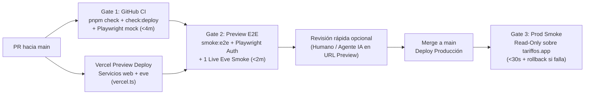

# Plan de CI/CD con Ambiente Preview y Compuertas de Release — TariffOS v3

**Fecha:** 27 de noviembre de 2026  
**Estado:** Listo para ejecutar  
**Referencias:** [.github/workflows/ci.yml](file:///Users/afernandez/projects/tariffos-v3/.github/workflows/ci.yml) · [vercel.ts](file:///Users/afernandez/projects/tariffos-v3/vercel.ts) · [scripts/smoke-e2e.mjs](file:///Users/afernandez/projects/tariffos-v3/scripts/smoke-e2e.mjs) · [QUALITY_HARNESS_AND_PLAYWRIGHT_PLAN.md](file:///Users/afernandez/projects/tariffos-v3/docs/QUALITY_HARNESS_AND_PLAYWRIGHT_PLAN.md)

---

## 1. Objetivo

Pasar del esquema actual (push directo a `main` con validación manual) a un **pipeline CI/CD ligero, barato y seguro** donde todo cambio:
1. Se valide estática y funcionalmente en **GitHub Actions** al abrir un Pull Request.
2. Se despliegue automáticamente en un **Ambiente Preview real de Vercel** (que gracias a [vercel.ts](file:///Users/afernandez/projects/tariffos-v3/vercel.ts) levanta **tanto `web` como `eve` en el mismo dominio Preview**).
3. Ejecute automáticamente las **pruebas de subida en Preview** (HTTP smoke + Playwright UI + 1 smoke vivo de Eve + aislamiento multi-tenant) **antes** de permitir el merge a `main` (Producción).
4. Ejecute un **Smoke Read-Only Post-Deploy** sobre `https://tariffos.app` tras promover a producción.

---

## 2. Flujo Completo del Pipeline (`PR -> Preview -> Producción`)

---

## 3. Configuración del Ambiente Preview (Infraestructura Mínima)

### 3.1 Vercel Preview + Protection Bypass
- En Vercel (*Settings → Git*): cada rama/PR genera un Preview Deployment con ambos servicios definidos en [vercel.ts](file:///Users/afernandez/projects/tariffos-v3/vercel.ts) (`web` y `eve` en el mismo origen `/eve/v1/*`, por lo que `NEXT_PUBLIC_EVE_URL` permanece vacío).
- En Vercel (*Settings → Deployment Protection*): activar **Protection Bypass for Automation** y guardar el secreto `VERCEL_AUTOMATION_BYPASS_SECRET` tanto en Vercel como en GitHub Actions Secrets.
  - Playwright y `smoke-e2e.mjs` enviarán el header `x-vercel-protection-bypass: $VERCEL_AUTOMATION_BYPASS_SECRET` (más `x-vercel-set-bypass-cookie: true` en navegador) para probar el Preview privado sin abrirlo al público.

### 3.2 Estrategia de Base de Datos y Auth en Preview
- **Fase Inicial (Costo \$0 adicional — Aislamiento por Tenant Efímero `@tariffos.internal`):**
  - Preview conecta al proyecto Supabase actual usando cuentas efímeras `e2e.*@tariffos.internal` creadas al inicio del job y **eliminadas obligatoriamente en el `teardown` (`if: always()`)**, respetando RLS y sin tocar jamás datos de clientes reales ni `platform_admins` reales.
  - **Regla de seguridad:** cualquier PR que modifique `packages/database/prisma/**` o `supabase/migrations/**` pasa por `pnpm check:db:static` y solo aplica migraciones aditivas compatibles hacia atrás antes del merge (o usa una rama de Supabase Branching si la migración es estructural).
- **Supabase Auth Redirect URLs:**
  - Agregar en *Supabase Dashboard → Authentication → URL Configuration → Redirect URLs* el patrón de tus previews de Vercel (ej. `https://tariffos-v3-*-*.vercel.app/auth/callback` y `https://tariffos-v3-*-*.vercel.app/**`).
- **Inngest en Preview:**
  - Usar las keys de branch/staging de Inngest en el scope *Preview* de Variables de Entorno de Vercel para no mezclar colas de lotes de prueba con producción.

---

## 4. Qué Pruebas Deben Correr al Subir la App (Las 3 Compuertas)

### Compuerta 1 — PR CI (`.github/workflows/ci.yml` — antes de tocar la nube)
Corre en cada `pull_request` hacia `main`:
1. **`pnpm check`**: TypeScript `strict`, Oxlint (`rules-of-hooks` + `jsx-a11y` en error), límite `<= 200` LOC, higiene de repo, guardrails estáticos de DB y Vitest en los 7 paquetes.
2. **`pnpm check:deploy`**: build limpio desde cero de `packages/*` + `eve build` + `next build --webpack`.
3. **`pnpm test:e2e`** *(Playwright con SSE determinista sobre `next start` local)*:
   - Valida las 6 specs UI (`public-funnel`, `auth-routing`, `modals-and-overlays`, `canvas-workflows`, `batch-triage-keyboard`, `mobile-viewport`) con `0 console.error` y `0 pageerror`.

---

### Compuerta 2 — Verificación en Vivo sobre Vercel Preview (`.github/workflows/preview-e2e.yml`)
Se dispara automáticamente cuando Vercel notifica `deployment_status` con `state == 'success'` y `environment == 'Preview'`. Ejecuta **exactamente las pruebas que solo un entorno desplegado real puede validar**:

| Bloque de Prueba en Preview | Qué verifica exactamente | Tiempo / Costo |
|---|---|---|
| **2.1 Smoke HTTP y Contratos Públicos** (`pnpm smoke:e2e -- --url $PREVIEW_URL --strict`) | `GET /` (planes B2B), `GET /login`, redirects `307` en `/activate-plan` y `/admin/billing`, `GET /samples/dictamen-ejemplo-tariffos.pdf` (`application/pdf`), `GET /api/plans/public` (`>= 3` planes), `GET /api/exchange-rates/latest` (tasa BCV válida), `GET /api/inngest` (`x-inngest-sdk-handled: true`) y rechazo `401/403` sin sesión en `POST /api/batch/upload-url`. | ~5s · \$0 |
| **2.2 Auth SSR + Guardias por Rol en Navegador** (`auth-routing.spec.ts` contra `$PREVIEW_URL`) | Login real contra Supabase SSR con cookies `Secure`/`SameSite` reales de HTTPS; verifica que `broker` activo entra a `/app` (`200`), `onboarding` va a `/onboarding`, y `super_admin` con agencia entra a `/app` y `/admin` **sin bucles `307`**. | ~15s · \$0 |
| **2.3 Seguridad Multi-Tenant y Storage Privado** | Verifica que un usuario autenticado del Tenant A recibe `403 Forbidden` al intentar firmar/leer un `storageKey` de otro `tenantId` en `/api/batch`, `/api/billing/payments` o `/api/admin/billing/receipts`. | ~5s · \$0 |
| **2.4 Live Eve + Retrieval + PDF Smoke (`live-eve-smoke.spec.ts`)** | **1 sola clasificación real** en `/app` a través del servicio `eve` desplegado en Vercel (`vercel.ts` + Vercel OIDC + OpenRouter/LLM + `pgvector` HNSW en Supabase): confirma `202/200` en `/eve/v1/*`, renderizado de `VerdictCard` + `DossierView`, refresco de tasa BCV y exportación de PDF sin `console.error`. | ~25s · < \$0.01 |
| **2.5 Teardown Garantizado (`if: always()`)** | Ejecuta el script de limpieza E2E borrando `DecisionArtifact`, sesiones, membresías, tenant `@tariffos.internal` y usuarios efímeros de Supabase Auth aunque haya fallado algún paso previo. | ~3s · \$0 |

> [!IMPORTANT]
> **Branch Protection en GitHub (`main`):** configurar `main` para exigir que pasen **Compuerta 1 (`verify`)** y **Compuerta 2 (`preview-e2e`)** antes de habilitar el botón *Squash and merge*. Así ningún commit roto llega a `https://tariffos.app`.

---

### Compuerta 3 — Post-Deploy en Producción (`.github/workflows/prod-smoke.yml`)
Se dispara cuando Vercel termina el deploy de `Production` (`https://tariffos.app`).  
**Regla absoluta en Producción: 100% Read-Only (cero creación/borrado de usuarios ni escrituras en BD).**

1. **Smoke HTTP estricto:** `node scripts/smoke-e2e.mjs --url https://tariffos.app --strict` (con soporte de header bypass si aplica o directo sobre dominio público).
2. **Playwright Headless Read-Only (`prod-readonly.spec.ts`):**
   - Abre `https://tariffos.app/` y `https://tariffos.app/login` en Desktop y Mobile.
   - Verifica `0 console.error`, `0 pageerror`, fuentes cargadas (`200`), CSS compilado (`200`), `PlanRecommender` interactivo y redirección limpia de `/app` → `/login`.
3. **Alerta + Rollback rápido:**
   - Si cualquier check falla en producción, el workflow marca fallo crítico (notificación GitHub/Slack/email) e imprime el comando inmediato `pnpm dlx vercel rollback --yes` para revertir al deployment previo en segundos.

---

## 5. Checklist de Implementación Paso a Paso (Orden de Ejecución)

1. **Paso 1 — Extender `scripts/smoke-e2e.mjs` (~15 min):**
   - Soportar variable `VERCEL_AUTOMATION_BYPASS_SECRET` para inyectar automáticamente `x-vercel-protection-bypass` cuando se apunte a una URL `*.vercel.app`.
   - Agregar check de `/app` sin sesión (`307 -> /login`) y `/api/workspace/threads` sin sesión (`401`).
2. **Paso 2 — Script oficial de provisión/teardown E2E (`scripts/e2e-accounts.ts`, ~20 min):**
   - Promover la lógica ya probada de cuentas efímeras `@tariffos.internal` (incluyendo borrado completo de `DecisionArtifact` y tablas hijas de `Tenant` + guardia dura que aborta si el dominio no termina en `@tariffos.internal`).
3. **Paso 3 — Configurar Vercel + Supabase para Preview (~15 min manuales):**
   - Crear `VERCEL_AUTOMATION_BYPASS_SECRET` en Vercel y cargarlo en GitHub Secrets junto con `NEXT_PUBLIC_SUPABASE_URL` y `SUPABASE_SERVICE_ROLE_KEY` (solo para el job `preview-e2e`).
   - Añadir el wildcard `https://*-*.vercel.app/**` en Redirect URLs de Supabase Auth.
4. **Paso 4 — Workflows de GitHub Actions (~30 min):**
   - Actualizar [.github/workflows/ci.yml](file:///Users/afernandez/projects/tariffos-v3/.github/workflows/ci.yml) para incluir `pnpm test:e2e` (determinista).
   - Crear `.github/workflows/preview-e2e.yml` (`on: deployment_status` para `Preview` con `if: always()` teardown).
   - Crear `.github/workflows/prod-smoke.yml` (`on: deployment_status` para `Production`, 100% read-only).
5. **Paso 5 — Activar Branch Protection en `main` (~5 min en GitHub):**
   - Requerir PR + checks `verify` y `preview-e2e` en verde antes de hacer merge a `main`.
